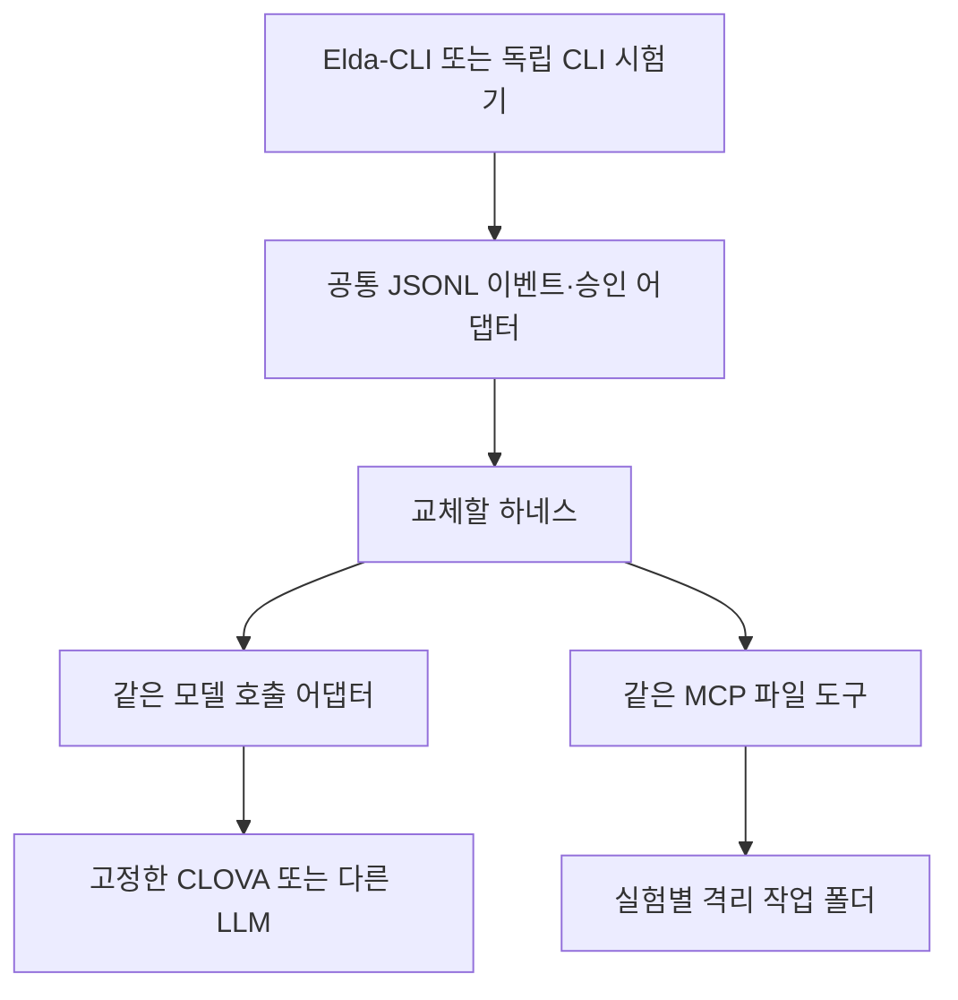

# Elda-CLI ② 자체 하네스 구축 방식 조사

조사 기준: **2026-11-10, Asia/Seoul**. 대상 저장소: **clova-api-lab**.

후속 작업: 아래 조사 이후 Vercel·PydanticAI·Pi 프로토타입을 구현·실행했다. 최신 상태는 [51개 공통 검사와 실제 장단점 보고서](HARNESS-PROTOTYPE-RESULTS-2026-11-10.md)에 있다. 이 문서의 “조사 단계” 표현은 조사 당시 범위를 설명한다.

## 1. 결론과 조사 범위

현재 LangGraph 하네스를 기준으로, **직접 구현을 포함한 23개 실행 후보**와 **서비스형 구성 3개·영속 실행 보완 방식 1개**를 조사했다. LangChain 계열, Python 계열, 중국계·코딩 계열을 세 에이전트가 병렬 조사하고, 루트가 공급자 SDK·공통 연결 구조·시험 순서를 통합했다. 공식 문서와 공식 저장소를 실제로 열어 확인했으며, 인터넷의 모든 프로젝트를 빠짐없이 열거했다는 의미는 아니다.

목적은 **같은 LLM을 서로 다른 자체 하네스로 운전하여 Elda-CLI ②에서 비교**하는 것이다. 새 API 비교를 ①·③으로 확장하지 않는다. 여기서 자체 하네스는 모든 코드를 처음부터 작성한다는 뜻에 한정하지 않는다. 공개 SDK를 조립하더라도 우리가 실행 프로세스, 모델 연결, 도구 권한, 승인 정책과 기록을 소유하면 이번 ②의 후보가 된다.

우선순위는 **현재 LangGraph 기준선 → Vercel AI SDK → PydanticAI → Pi agent-core → AgentScope → Mastra**로 제안한다. 이것은 현재 TypeScript 코드와의 연결 비용, 서로 다른 구현의 비교 가치, 독립 테스트 수단에 근거한 판단이다. 성능 순위나 실제 통과 결과가 아니다. 각 단계의 완료 후 다음 후보를 붙이는 순서이며 한 번에 전부 구현할 필요는 없다.

**이번에 완료한 것은 조사·설계·목록 작성이다.** 새 프레임워크 설치, 하네스 구현, 모델 API 호출, 실행 시험, 웹 배포는 하지 않았다. 기존 구현·실제 호출 이력은 [작업 기록](WORKLOG-2026-11-10.md)에 별도로 있다. 이 문서와 README 링크만 이 프로젝트 안에 작성하며 reference 내부와 자매 프로젝트를 변경하지 않는다.

## 2. 이름을 같은 층으로 비교하면 안 되는 이유



위 그림은 **목표 비교 구조**다. 현재 구현에서 하네스를 임의로 선택하는 공통 플러그인 로더가 이미 존재한다는 뜻은 아니다.

| 층 | 담당 | 이번 비교에서의 처리 |
|---|---|---|
| LLM API | 추론, tool call 생성, usage | 하네스 비교 중에는 공급자·모델·설정을 고정 |
| 모델 Wrapper / Brain | 메시지·도구 스키마·응답·오류·usage 변환 | 재사용하거나 동등한 계약으로 연결 |
| MCP | 도구 발견·호출·결과 전달 | 동일 서버·도구·작업장 정책 사용 |
| 하네스 | 모델↔도구 반복, 승인, 중단, 상태, 한도 | 이번에 교체해서 비교할 대상 |
| CLI / 웹 | 입력, 출력, 승인 UI, 세션 조작 | 하네스 실행 사실과 실제 Elda-CLI 경유 여부를 따로 기록 |
| 영속 실행 계층 | 장애 후 이어 실행, 긴 승인 대기 | 기본 루프 비교 후 별도 실험 |

**LangGraph → LangChain createAgent → Deep Agents는 같은 실행 계열의 서로 다른 추상화 수준**이다. 독립 엔진 세 개로 세면 안 된다. 직접 그래프와 고수준 에이전트·완성형 하네스의 개발량 차이를 비교하는 데 의미가 있다. [공식 계층 설명](https://www.langchain.com/oss-overview)

또한 다음은 서로 다른 기능이다.

- 대화 이력을 저장하는 것.
- 승인 대기 상태를 저장하고 새 프로세스에서 재개하는 것.
- 실행 도중 장애가 나도 이미 수행한 효과를 중복 실행하지 않도록 복구하는 것.

프레임워크가 어느 하나를 제공한다고 나머지까지 완성됐다고 판정하지 않는다. Elda의 ①②③과 일부 프레임워크의 plan/build 같은 내부 작업 모드도 별개다.

## 3. 실행 후보 23개

표의 지원은 공식 자료에서 확인한 범위이며 **우리 CLOVA 연결이나 Elda 적합성 시험을 통과했다는 의미가 아니다**. 적용 판단은 현재 코드 구조를 바탕으로 한 설계 의견이다. 라이선스와 세부 제한은 뒤에서 구분한다.

| 번호 | 후보·구축 방식 | 주로 검토한 언어 | 제공하는 핵심 | ②에서 볼 점 |
|---|---|---|---|---|
| 01 | 직접 tool-calling 루프 | TS/Python | 필요한 정책만 직접 구성 | 가장 단순한 기준군. 승인·중단·저장 책임도 직접 부담 |
| 02 | [LangGraph](https://docs.langchain.com/oss/javascript/langgraph/overview) | TS | 명시적 상태 그래프, interrupt, checkpoint | 현재 기준군. 기존 Brain·MCP 재사용 용이 |
| 03 | [LangChain createAgent](https://docs.langchain.com/oss/javascript/langchain/human-in-the-loop) | TS | 표준 agent loop, middleware, HITL | 같은 LangGraph 계열의 구현량 비교 |
| 04 | [Deep Agents](https://docs.langchain.com/oss/javascript/deepagents/overview) | TS | 계획, 파일 컨텍스트, 요약, subagent, HITL | 장기 작업용. 기본 도구·프롬프트 영향을 분리 |
| 05 | [Vercel AI SDK ToolLoopAgent](https://ai-sdk.dev/docs/agents/building-agents) | TS | 도구 반복, provider 추상화, 승인 정책 | 작은 독립 TS 후보. 공식 model mock 제공 |
| 06 | [Mastra Agent / Harness](https://mastra.ai/docs/harness/overview) | TS | 에이전트, 세션, workspace, 승인, subagent | CLI 제품 기능에 가까움. durable 기능은 별도 평가 |
| 07 | [Pi agent-core](https://github.com/earendil-works/pi/blob/main/packages/agent/README.md) | TS | 모델 스트림 주입, 이벤트·도구 루프, 실행 전후 hook | 최소 조립형 후보. coding-agent CLI 전체 재사용과 구분 |
| 08 | [PydanticAI / Harness](https://pydantic.dev/docs/ai/harness/) | Python | 타입 모델, deferred 승인, MCP, 별도 Harness 저장 | mock·승인·재개를 분리 검증하기 좋은 독립 후보 |
| 09 | [Agno](https://docs.agno.com/hitl/user-confirmation) | Python | 도구 확인, MCP, DB 기반 세션·run 재개 | SQLite 승인 대기·새 프로세스 재개 비교 |
| 10 | [smolagents](https://huggingface.co/docs/smolagents/reference/models) | Python | ToolCallingAgent 또는 CodeAgent, custom model | 첫 비교는 함수 호출형. 코드 실행형은 별도 실험 |
| 11 | [LlamaIndex Workflows / FunctionAgent](https://developers.llamaindex.ai/python/framework/understanding/agent/human_in_the_loop/) | Python | 이벤트 기반 흐름·HITL·context | RAG·문서 도구가 커질 때 가치 상승 |
| 12 | [Haystack Agent](https://docs.haystack.deepset.ai/docs/3.3/human-in-the-loop) | Python | ChatGenerator, 파이프라인, ConfirmationHook | RAG 파이프라인 비교. 3.x 재개 제한 주의 |
| 13 | [CrewAI / Flows](https://docs.crewai.com/v1.15.39/en/concepts/flows) | Python | 역할·팀·workflow·hook·checkpoint | 멀티에이전트 업무 흐름 비교 |
| 14 | [OpenAI Agents SDK](https://developers.openai.com/api/docs/guides/agents/sdk) | TS/Python | agent loop, handoff, tools/MCP, 승인·상태 | 자체 프로세스 실행 가능. 비 OpenAI 모델은 adapter 확인 |
| 15 | [Google ADK](https://adk.dev/) | Python/TS 등 | 에이전트·그래프·workflow·세션·평가 | 모델 connector와 기능별 언어 지원 차이를 확인 |
| 16 | [Strands Harness SDK / Harness](https://strandsagents.com/docs/user-guide/sdk/) | Python/TS | 모델·도구 루프, session·intervention·완성형 구성 | SDK 조립과 기본 완성형 구성을 분리 비교 |
| 17 | [Microsoft Agent Framework](https://learn.microsoft.com/en-us/agent-framework/concepts/harness) | Python/.NET, Go | agent·workflow·HarnessAgent·승인·메모리 | 기본 기능이 넓음. 언어별 구성 차이 존재 |
| 18 | [AgentScope 2.0](https://docs.agentscope.io/en/versions/2.0.11) | Python | Toolkit·middleware·MCP·권한·중단·세션 | 중국계 범용 하네스의 독립 비교군 |
| 19 | [Qwen-Agent](https://github.com/QwenLM/Qwen-Agent) | Python | 함수 호출·ReAct·OpenAI 호환 endpoint·MCP | Qwen 도구 호출 설계 비교. CLOVA parser 적합성 별도 |
| 20 | [CAMEL](https://github.com/camel-ai/camel) | Python | ChatAgent·RolePlaying·Workforce·MCP | 역할 분담·팀 실험에 적합 |
| 21 | [OpenHands Software Agent SDK](https://docs.openhands.dev/sdk) | Python | 코딩 실행, Conversation·Workspace·승인·저장 | 코딩용 하네스 비교군. TS 패키지는 서비스 client |
| 22 | [Letta Agent SDK](https://docs.letta.com/agent-sdk) | JS/TS | 기억·세션·지속 agent·client tools | 장기 기억·재접속 특화 비교군 |
| 23 | [DSPy ReAct / 직접 모듈 조합](https://dspy.ai/current/) | Python | ReAct, typed signature, 평가·최적화 | 프롬프트·전략 최적화 비교. CLI 운영 계약은 별도 구성 |

직접 루프의 로컬 참고 구현은 [harness.ts](runtime/clova/harness.ts)이며, 현재 웹 실행 엔진은 [langgraph.ts](runtime/clova/langgraph.ts)다. 과거 직접 루프에 현재 승인·오류 계약이 모두 동등하게 구현됐다고 가정하지 않는다. 비교에 넣기 전 기능 차이를 정리해야 한다.

## 4. TypeScript 후보: 빠르게 붙일 수 있는 차이

### 4.1 LangGraph / LangChain / Deep Agents

- LangGraph는 흐름을 직접 조립하고 checkpointer를 연결하는 방식이다. **현재 우리 그래프는 `.compile()`에 persistent checkpointer를 연결하지 않았으며 대화·승인 상태는 메모리 중심**이다. 프레임워크가 복구를 지원한다는 이유로 현재 구현의 재시작 복구를 완료 처리하면 안 된다. [Persistence](https://docs.langchain.com/oss/javascript/langgraph/persistence)
- LangChain createAgent는 HITL middleware로 승인·수정·거절 등을 처리하며 checkpoint 구성이 필요하다. 기존 Brain을 LangChain chat model 인터페이스로 변환하는 작업은 남는다. [HITL](https://docs.langchain.com/oss/javascript/langchain/human-in-the-loop)
- Deep Agents는 자체 프로세스·컨테이너에서 구동할 수 있다. 계획·파일 backend·메모리·subagent가 더해진다. subagent 도구의 승인도 지원하지만 체크포인터가 필요하다. [개요](https://docs.langchain.com/oss/javascript/deepagents/overview), [Subagent HITL](https://docs.langchain.com/oss/javascript/deepagents/human-in-the-loop)
- LangChain MCP 최신 문서는 adapter 2.x의 `MCPAdapter`를 안내한다. 구형 `MultiServerMCPClient` 예제를 그대로 섞지 않고 선택한 버전에 맞춰야 한다. 첫 실험에서는 현재 MCP client를 유지하는 편이 변수가 적다. [MCP](https://docs.langchain.com/oss/javascript/langchain/mcp)

### 4.2 Vercel AI SDK

- 현재 실제 문서는 v7이다. ToolLoopAgent는 작은 agent loop를 구성하기 좋으며, 현재 승인 API는 `toolApproval`이다. 구형 `needsApproval`은 이 경로에서 deprecated다. [승인 정책](https://ai-sdk.dev/docs/agents/policy-tool-approvals)
- **ToolLoopAgent의 subagent 도구 승인 흐름은 현재 문서상 지원하지 않는다.** 첫 실험은 단일 agent로 고정한다. [Subagents 제한](https://ai-sdk.dev/docs/agents/subagents)
- 기본 ToolLoopAgent의 메모리 실행과 별도 WorkflowAgent의 영속 실행을 구분한다. WorkflowAgent는 Workflow 5 런타임이 필요하며 이쪽 승인 API에는 `needsApproval`이 쓰인다. [WorkflowAgent](https://ai-sdk.dev/docs/agents/workflow-agent)
- 공식 `ai/test`의 `MockLanguageModelV4`로 결정적인 모델 응답을 만들 수 있다. 기존 TS Brain을 custom model로 감싸는 안은 **구현 제안**이며 아직 작성하지 않았다. [테스트](https://ai-sdk.dev/docs/ai-sdk-core/testing)
- MCP client는 stdio/HTTP/SSE를 지원하지만 모든 MCP 기능을 구현한 것은 아니다. 자동 세션 지속·재개 스트림·notification의 제한을 별도로 확인한다. [MCP](https://ai-sdk.dev/docs/ai-sdk-core/mcp-tools)

### 4.3 Mastra

- AgentController는 세션·작업공간·모델 전환·승인 등을 묶는다. plan/build/review는 Mastra 내부 모드이며 Elda ①②③ 지원 표기가 아니다. [AgentController](https://mastra.ai/docs/harness/agent-controller)
- supervisor 아래 중첩 subagent의 승인을 상위로 전달한다. 중단된 run을 새 프로세스에서 찾으려면 영속 저장소가 필요하다. [HITL](https://mastra.ai/docs/agents/human-in-the-loop)
- Durable Agent는 현재 beta다. crash recovery는 기본으로 켜지지 않으며 영속 저장소와 복구 설정이 필요하다. 스트림 replay cache와 실행 snapshot은 다른 저장 대상이다. [Durable agents](https://mastra.ai/docs/harness/durable-agents)
- OpenAI 호환 endpoint와 provider 객체, MCPClient를 제공한다. tool mock만 사용한다고 모델 호출도 없어지는 것은 아니므로 완전 offline 모델 stub은 별도 구성한다. [모델](https://mastra.ai/models), [MCP](https://mastra.ai/docs/connections/mcp), [테스트 설명](https://mastra.ai/articles/ai-agent-testing)

### 4.4 Pi agent-core

- 현재 공식 저장소는 `earendil-works/pi`다. agent-core에 custom `streamFn`, `beforeToolCall`, `afterToolCall`을 주입할 수 있다. 우리 모델·승인·MCP 연결을 붙이는 작은 기준군으로 적합하다는 판단이다. [agent-core](https://github.com/earendil-works/pi/blob/main/packages/agent/README.md)
- coding-agent에는 현재 MCP 기능이 있다. 그러나 agent-core import만으로 coding-agent의 도구·MCP·저장 기능을 모두 얻는 것은 아니다. [coding-agent MCP](https://github.com/earendil-works/pi/blob/main/packages/coding-agent/docs/mcp.md)
- 완성 coding-agent CLI를 실행하는 방식과 core를 사용해 Elda용 루프를 만드는 방식을 구분한다. 이번 우선 후보는 후자다. 도구 hook으로 승인 게이트를 만들 수 있다는 것과 그 기능이 우리 코드에 이미 있다는 것도 구분한다.

## 5. Python 후보: 승인·mock·재개를 중심으로

| 후보 | 승인 방식 | 저장·재개 | 독립 테스트와 남는 작업 |
|---|---|---|---|
| PydanticAI | deferred tools, `requires_approval`, ApprovalRequiredToolset | 별도 Harness의 StepPersistence, 파일/SQLite 등 | TestModel·FunctionModel 제공. `ALLOW_MODEL_REQUESTS=False`로 실모델 요청 차단 |
| Agno | `requires_confirmation`, MCP 승인 도구 지정 | DB에 저장한 run/session으로 새 프로세스 재개 | 공통 mock HTTP 또는 model stub 구성 필요 |
| smolagents | 공식 사례는 계획 callback HITL | `reset=False`는 메모리 유지이며 durable 복구와 다름 | 도구마다 실행 전 승인 wrapper를 구성해야 함 |
| LlamaIndex | InputRequiredEvent/HumanResponseEvent로 대기 | Context 직렬화 후 애플리케이션에서 저장·복원 | 전체 MCP 도구에 승인 정책을 직접 적용 |
| Haystack 3.x | `before_tool` ConfirmationHook | Agent 내부 breakpoint/snapshot 재개는 제거됨 | 저장한 대화와 실행 위치 복구를 구분 |
| CrewAI | pre-tool hook + human input, 거절은 HookAborted | Flow persist와 별도 JSON/SQLite checkpoint | 복원 후 hook·closure·승인 정책 유지 검사 필요 |

표의 공식 근거: [PydanticAI 테스트](https://pydantic.dev/docs/ai/guides/testing/), [deferred tools](https://pydantic.dev/docs/ai/tools-toolsets/deferred-tools/), [StepPersistence](https://pydantic.dev/docs/ai/harness/step-persistence/), [Agno 승인](https://docs.agno.com/hitl/user-confirmation), [smolagents HITL](https://huggingface.co/docs/smolagents/examples/plan_customization), [LlamaIndex HITL](https://developers.llamaindex.ai/python/framework/understanding/agent/human_in_the_loop/), [state](https://developers.llamaindex.ai/python/framework/understanding/agent/state/), [Haystack HITL](https://docs.haystack.deepset.ai/docs/3.3/human-in-the-loop), [migration](https://docs.haystack.deepset.ai/docs/3.3/migration), [CrewAI hooks](https://docs.crewai.com/v1.15.39/en/learn/tool-hooks), [checkpoint](https://docs.crewai.com/v1.15.39/en/concepts/checkpointing).

실제 연결 시 특별히 확인할 부분:

1. **PydanticAI:** MCP toolset 전체에 승인 wrapper를 적용할 수 있다. FunctionModel로 create/edit/undo/read 순서를 재현한다. Harness 저장과 Temporal/DBOS 같은 durable 엔진의 역할을 분리한다. [Toolsets](https://pydantic.dev/docs/ai/tools-toolsets/toolsets/), [MCP](https://pydantic.dev/docs/ai/mcp/client/), [Durable execution](https://pydantic.dev/docs/ai/capabilities/durable_execution/overview/)
2. **Agno:** MCP 승인 목록에 실제 도구 이름을 빠짐없이 넣고 동일 DB·run_id·session_id로 재개한다. session_id만 지정했다고 저장되는 것은 아니다. [MCP 승인 예제](https://docs.agno.com/examples/agents/human-in-the-loop/confirmation-required-mcp-toolkit), [Sessions](https://docs.agno.com/sessions/overview)
3. **smolagents:** 현재 모델 클래스는 OpenAIModel이며 구형 OpenAIServerModel 예제와 구분한다. 먼저 ToolCallingAgent를 비교하고, Python 코드를 생성·실행하는 CodeAgent는 다른 실험으로 둔다. MCP의 thread·연결 종료도 검사한다. [Models](https://huggingface.co/docs/smolagents/reference/models), [Tools](https://huggingface.co/docs/smolagents/reference/tools)
4. **LlamaIndex:** 일반 MockLLM이 있다고 정확한 function-call fixture까지 구현됐다고 가정하지 않는다. 별도 MCP integration package가 필요하다. [MCP](https://developers.llamaindex.ai/python/framework/module_guides/mcp/llamaindex_mcp/)
5. **Haystack:** 승인 화면에 보이는 모델 인자와 뒤에 state에서 주입되는 인자를 구분한다. 최종 효과 인자 전체를 승인받아야 하면 보완한다. 2.x snapshot 설명을 3.x에 적용하지 않는다. [HITL](https://docs.haystack.deepset.ai/docs/3.3/human-in-the-loop)
6. **CrewAI:** 일반 예외 대신 문서의 HookAborted를 사용해야 거절이 실행 차단으로 연결된다. 전역 hook이 다음 시험에 남지 않도록 한다. [Tool hooks](https://docs.crewai.com/v1.15.39/en/learn/tool-hooks)

## 6. 공급자 SDK도 자체 하네스 재료가 된다

| 후보 | 문서에서 확인한 구성 | 이번 ②에 적용할 때의 판단 |
|---|---|---|
| OpenAI Agents SDK | TS/Python의 앱 내부 loop, tools/MCP, approval interruption·state 재개, 비 OpenAI provider/adapter 경로 | 관리형 Agents API와 구분. 자체 프로세스 SDK를 사용하며 CLOVA adapter는 별도 검증 |
| Google ADK | 모델 connector, MCP, agent·workflow·세션·승인 | Google 모델만 가능한 것은 아님. 기능별 지원 언어·저장 조합을 고정해야 함 |
| Strands | SDK로 조립하거나 완성형 Harness 사용. MCP·session·intervention·custom provider | AWS 배포를 비교의 필수 전제로 두지 않고 로컬 SDK부터 검사 |
| Microsoft Agent Framework | 모델 client, MCP, agent·workflow, HarnessAgent의 계획·메모리·승인·관측 | 기본 web search·도구·자동 승인 규칙을 공통 비교 조건에 맞춰 명시적으로 설정 |

OpenAI 근거: [SDK](https://developers.openai.com/api/docs/guides/agents/sdk), [모델·provider](https://developers.openai.com/api/docs/guides/agents/models), [stdio/HTTP MCP](https://developers.openai.com/api/docs/guides/agents/integrations-observability), [승인·재개](https://developers.openai.com/api/docs/guides/agents/guardrails-approvals). 비 OpenAI 모델 연결은 언어별 adapter 표면을 사용하며 일부 기능은 API 경로에 의존한다. **CLOVA 완전 호환을 보장한 문서는 아니다.**

Google ADK의 action confirmation은 실험적 기능으로 표시돼 있으며, 해당 문서에는 DatabaseSessionService·VertexAiSessionService 조합 제한이 있다. TS는 ToolContext를 통해 직접 확인 흐름을 구성한다. 다른 언어의 예제를 그대로 옮겨 쓰지 않는다. [승인](https://adk.dev/tools-custom/confirmation/), [MCP](https://adk.dev/tools-custom/mcp-tools/), [모델](https://adk.dev/agents/models/litellm/)

Strands의 cancel과 interrupt는 다르다. 취소 요청이 모든 외부 도구 효과를 되돌리는 것은 아니며 provider·도구의 협조 여부를 확인해야 한다. SDK 조립과 Harness의 기본 프롬프트·도구·메모리를 사용한 결과를 별도 기록한다. [Harness SDK](https://strandsagents.com/docs/user-guide/sdk/), [Agent loop](https://strandsagents.com/docs/user-guide/sdk/agents/agent-loop/), [승인](https://strandsagents.com/docs/user-guide/sdk/agents/approve-before-acting/)

Microsoft Harness는 기존 Agent Framework 구성 요소를 묶은 것이다. .NET/Python/Go의 기본·선택 기능이 서로 다르다. [Harness capability matrix](https://learn.microsoft.com/en-us/agent-framework/concepts/harness)

**AutoGen은 신규 우선 후보에서 제외한다.** 조사 시점 공식 저장소는 archived·Microsoft 유지보수 종료와 Agent Framework 이행을 명시한다. 검색에 남아 있는 예전 maintenance-mode 설명과 현재 README를 구분했다. [공식 저장소](https://github.com/microsoft/autogen)

## 7. 중국계·코딩·장기 기억 후보

| 후보 | 공식 확인 사항 | 실제 시험에서 추가 확인할 점 |
|---|---|---|
| AgentScope 2.0 | 다수 모델·custom model, stdio/HTTP MCP, allow/deny/확인 정책, 중단·HITL. Agent Service에 영속 세션·workspace | 1.x와 2.0 API 혼용 금지. 첫 비교는 Python SDK worker로 단순화 |
| Qwen-Agent | OpenAI 호환 model_server, MCP 설정 | Qwen 중심 parser와 CLOVA 응답의 적합성. 범용 승인·durable checkpoint는 이번 자료만으로 미확인 |
| CAMEL | OpenAICompatibleModel, MCPToolkit, ChatAgent·Workforce | HumanToolkit은 질문 도구이며 모든 효과를 막는 승인 게이트가 아님 |
| OpenHands SDK | Python Agent·Conversation·Workspace, MCP, confirmation 정책, conversation persistence | 코딩 기본 도구를 제한하고 Elda MCP 도구만으로 먼저 비교 |
| Letta SDK | 현재 JS/TS SDK, 로컬/App Server, custom provider, client tools/MCP, 승인·지속 agent | 기억·자동 toolset 선택의 영향을 통제. 구형 Python 서버 설명과 구분 |

AgentScope: [FAQ·2.0 변경](https://agentscope.io/blog/agentscope-faq/), [2.0 문서](https://docs.agentscope.io/en/versions/2.0.11), [저장소](https://github.com/agentscope-ai/agentscope).

Qwen-Agent: [공식 모델·MCP 예제](https://github.com/QwenLM/Qwen-Agent).

CAMEL: [OpenAICompatibleModel](https://github.com/camel-ai/camel/blob/master/camel/models/openai_compatible_model.py), [MCPToolkit](https://github.com/camel-ai/camel/blob/master/camel/toolkits/mcp_toolkit.py), [HumanToolkit](https://github.com/camel-ai/camel/blob/master/camel/toolkits/human_toolkit.py).

OpenHands: [SDK](https://docs.openhands.dev/sdk), [승인](https://docs.openhands.dev/sdk/guides/security), [영속화](https://docs.openhands.dev/sdk/guides/convo-persistence), [MCP](https://docs.openhands.dev/sdk/guides/mcp). TS 패키지는 Python SDK 실행을 REST/WebSocket으로 다루는 client이며 동일한 인프로세스 TS 엔진이라고 표현하지 않는다.

Letta: [SDK](https://docs.letta.com/agent-sdk), [자체 호스팅](https://docs.letta.com/self-hosting), [모델](https://docs.letta.com/configuration/models), [권한](https://docs.letta.com/configuration/permissions), [MCP](https://docs.letta.com/agent-sdk/mcp). 현재 문서는 Node.js 22.19+ 로컬 런타임을 안내하며 V1 Python/Docker 경로는 legacy로 분리한다.

## 8. 다른 구축 방식과 보완 계층

| 방식 | 가능한 구성 | 이번 비교에서의 위치 |
|---|---|---|
| Dify 자체 호스팅 | Docker Compose/소스 실행, 게시 앱 REST API | CLI → 자체 서비스 → agent/workflow. 별도 JSONL·승인·중단 adapter 필요 |
| Flowise 자체 호스팅 | Node/Docker 실행, 시각적 flow와 REST API | SDK 내장형과 분리한 서비스형 비교 |
| n8n 자체 호스팅 | Webhook → workflow → LLM/tool → 응답 | 업무 자동화 방식 비교. CLI 세션 계약을 별도 연결 |
| Temporal 결합 | 기존 agent SDK의 모델·도구 작업을 durable workflow/activity로 구성 | 기본 하네스의 경쟁 후보라기보다 장애 복구 보완 계층 |

공식 근거: [Dify 배포](https://docs.dify.ai/en/self-host/deploy/overview), [API](https://docs.dify.ai/en/api-reference/guides/get-started), [Flowise 배포](https://docs.flowiseai.com/getting-started), [API](https://docs.flowiseai.com/api-reference), [n8n 호스팅](https://docs.n8n.io/deploy/host-n8n.md), [Webhook](https://docs.n8n.io/integrations/builtin/core-nodes/n8n-nodes-base.webhook), [Temporal Durable AI](https://docs.temporal.io/ai).

이 세 시각적 구성 제품은 자체 호스팅이 가능하다는 것을 확인했다. 모든 라이선스·유료 기능까지 동일하다는 뜻은 아니다. 서버·서비스 수가 늘어나므로 독립 CLI의 첫 기준군보다는 후속 비교군으로 둔다.

DSPy는 ReAct 또는 직접 도구 호출 모듈을 구성하고 평가·최적화할 수 있다. 첫 실험부터 자동 최적화를 켜면 하네스뿐 아니라 프롬프트도 달라진다. 고정 전략과 최적화 전략을 별도 실험으로 둔다. [도구 구성](https://github.com/stanfordnlp/dspy/blob/main/docs/docs/learn/programming/tools.md), [DSPy](https://dspy.ai/current/)

## 9. 무료 실행과 라이선스

**프레임워크 사용 조건, 모델 API 비용, 호스팅·관측 서비스 비용은 각각 별개**다. SDK가 공개됐다고 연결한 모델 호출이 무료가 되지 않는다. 무료 API 한도·가격·키 발급은 이번 하네스 조사에서 다시 검증한 항목이 아니다.

키 없이 하는 결정적 mock 시험은 실모델 API 비용 없이 구성할 수 있다. 로컬 모델은 외부 API 대신 로컬 자원을 쓰므로 완전한 무비용과 동일하지 않다. trace exporter·부가 검색·embedding 호출이 시험 중 자동 실행되지 않는지도 확인한다.

| 확인한 프로젝트 | 공식 표시·원문 기준 라이선스 |
|---|---|
| LangChainJS / LangGraphJS / DeepAgentsJS | [MIT](https://raw.githubusercontent.com/langchain-ai/langchainjs/main/LICENSE) / [MIT](https://raw.githubusercontent.com/langchain-ai/langgraphjs/main/LICENSE) / [MIT](https://raw.githubusercontent.com/langchain-ai/deepagentsjs/main/LICENSE) |
| Vercel AI SDK | [Apache-2.0](https://raw.githubusercontent.com/vercel/ai/main/LICENSE) |
| Mastra | [일반 코드 Apache-2.0, ee/ 별도 Enterprise License](https://raw.githubusercontent.com/mastra-ai/mastra/main/LICENSE.md) |
| Pi / OpenHands SDK | [MIT](https://raw.githubusercontent.com/earendil-works/pi/main/LICENSE) / [MIT](https://raw.githubusercontent.com/OpenHands/software-agent-sdk/main/LICENSE) |
| Qwen-Agent / AgentScope / CAMEL | [Apache-2.0](https://raw.githubusercontent.com/QwenLM/Qwen-Agent/main/LICENSE) / [Apache-2.0](https://raw.githubusercontent.com/agentscope-ai/agentscope/main/LICENSE) / [Apache-2.0](https://raw.githubusercontent.com/camel-ai/camel/master/LICENSE) |
| Letta Agent SDK / Code runtime | [Apache-2.0](https://raw.githubusercontent.com/letta-ai/letta-agent-sdk/main/LICENSE) / [Apache-2.0](https://raw.githubusercontent.com/letta-ai/letta-code/main/LICENSE) |
| PydanticAI / LlamaIndex / CrewAI | [MIT](https://github.com/pydantic/pydantic-ai) / [MIT](https://github.com/run-llama/llama_index) / [MIT](https://github.com/crewAIInc/crewAI) |
| smolagents / Agno / Haystack | [Apache-2.0](https://github.com/huggingface/smolagents) / [Apache-2.0](https://github.com/agno-agi/agno) / [Apache-2.0](https://github.com/deepset-ai/haystack) |

표는 이번에 확인한 코드 라이선스다. 모든 SDK·플랫폼의 전체 의존성 및 클라우드 약관을 감사한 표는 아니다. 특히 Agno를 과거 자료에 따라 MIT로 쓰거나 Mastra 저장소 전체를 Apache로 표현하지 않는다.

## 10. 우리 Wrapper에 연결하는 방법

### 방법 A: 기존 TypeScript Brain을 모델 인터페이스로 감싸기

Vercel·Pi·LangChain·Mastra 등 TS 후보는 기존 [provider.ts](runtime/clova/provider.ts)의 Brain을 각 SDK의 model/provider 인터페이스에 맞춰 변환하는 안을 우선 검토한다. 모델 호출만 변환하고 하네스 내부에서 현재 LangGraph를 다시 호출하지 않는다. 중첩된 두 agent loop가 생기면 비교 대상이 달라진다.

### 방법 B: Python worker + 공통 모델 gateway

PydanticAI·Agno·AgentScope는 JSONL subprocess로 붙일 수 있다. 모델에는 loopback 호환 gateway 또는 동등한 custom model adapter를 사용한다. **현재 HTTP Wrapper는 CLOVA 중심이며 OpenAI 입구는 stream:false만 지원**한다. 모든 신규 공급자와 모든 SDK의 streaming이 이미 호환된다고 가정하면 안 된다.

새 공급자까지 같은 Brain을 공유하려면 범용 내부 gateway나 RPC를 추가 구현해야 한다. SDK에서 공급자 API를 직접 호출하는 실험을 먼저 한다면, 모델 연결 방식이 달라진 사실을 결과에 적는다. 공정한 하네스 비교로 확대하기 전에 요청·응답·usage의 동등성을 확인한다.

### 공통 연결 계약

- 입력: 현재의 prompt/new/notify/approve/interrupt와 EOF 처리에 대응한다.
- 출력: 현재 JSONL envelope와 이벤트 의미를 유지한다. 각 SDK 원시 이벤트를 그대로 섞지 않는다.
- 도구: artifact_list/read/write/undo 네 개와 동일한 설명·스키마·결과를 사용한다.
- 승인: 기존 ②의 정책을 고정한다. 프레임워크의 위험도 자동 분류나 자동 승인 기본값으로 바꾸지 않는다.
- 중단: 승인 대기, 모델 대기, 도구 대기 각 단계에서 실제 동작을 구분한다. 중단을 rollback으로 표시하지 않는다.
- 상태: 같은 프로세스의 대화 유지와 재시작 복구를 각각 표시한다.
- 한도: SDK의 step/turn 정의가 다르므로 실제 모델 요청 수와 도구 실행 수를 공통 계수기로 별도 센다.
- 기록: 프레임워크 이름·버전·모델·설정·추가 구현한 기능·실행 경로·결과를 남긴다.

프레임워크 자체 승인 기능이 부족해 공통 adapter에서 보완했다면 **기본 지원**으로 채점하지 않는다. 기본 기능과 우리가 작성한 코드량을 함께 비교한다.

## 11. 우선 구현·검증 작업 순서

아래는 **후속 작업 목록**이다. 이번 조사에서 체크한 완료 항목이 아니다.

| 순서 | 작업 | 완료 판단 |
|---|---|---|
| 1 | 현재 LangGraph·Brain·MCP·fixture·승인 정책·버전을 기준선으로 고정 | 실행 경로와 설정을 같은 보고서로 재현 가능 |
| 2 | 독립 CLI 공통 시험 driver와 결과 schema 정리 | Elda 설치본·웹 서버·실키 없이 JSONL과 파일 효과 검사 |
| 3 | Vercel ToolLoopAgent 단일 agent adapter | scripted model + 실제 MCP로 공통 승인·취소·파일 시험 통과 |
| 4 | PydanticAI Python JSONL worker | FunctionModel과 실요청 차단 상태에서 같은 시험 통과 |
| 5 | Pi agent-core adapter | 기존 Brain 주입·실행 전 hook·EOF 정리가 같은 계약을 만족 |
| 6 | AgentScope 2.0 worker | 중국계 프레임워크의 권한·중단·MCP 흐름 비교 |
| 7 | Mastra Agent, 이후 AgentController | 동일 도구 조건 통과 후 nested approval·세션 확장 |
| 8 | LangChain createAgent / Deep Agents | 같은 계열의 개발량 비교와 장기 작업 기능 비교를 분리 |
| 9 | 같은 CLOVA 모델로 실호출 | 실제 파일·도구·usage·지연을 검증, mock 결과와 별도 저장 |
| 10 | 동일 하네스에서 추가 API 비교 | 키 등록·인증·모델 과제 성공을 구분. 공급자별 실패 기록 |
| 11 | 영속 복구 실험 | 승인 전/후와 도구 효과 전/후에서 종료·재시작, 중복 효과 검사 |
| 12 | 실제 Elda-CLI 사본 통합, 이후 기존 웹 연결 | 독립 CLI·실제 Elda 경유·웹 직접 실행의 결과를 각각 표시 |

Agno는 PydanticAI 다음에 Python 승인·SQLite 재개를 깊게 비교할 때 추가한다. OpenAI Agents SDK·Strands·ADK·Microsoft Agent Framework는 범용 SDK 차이를 넓힐 때, OpenHands·Letta는 코딩·장기 기억 과제로 확장할 때 우선도가 올라간다.

## 12. 독립 CLI 시험 목록과 판정 기준

첫 단계는 **scripted 모델 + 실제 로컬 MCP + 격리된 파일 작업장**이다. 모델 판단의 불확실성을 제거하고 하네스의 승인·효과·중단 계약을 먼저 검사한다. 모델 품질은 실호출 단계에서 측정한다.

| 우선 | 시험 | 통과 기준 |
|---|---|---|
| P0 | 시작·ready·JSONL | stdout에 깨진 JSON/진단 로그 없음, seq와 이벤트 순서 일관 |
| P0 | 생성 → 수정 → undo → read | 실제 파일 바이트가 fixture와 일치, undo를 write로 대체하지 않음 |
| P0 | 승인 대기 | 승인 전 파일·이력에 효과 없음 |
| P0 | 승인 허용·거절 | 허용된 호출만 실행, 거절 후 파일 불변 |
| P0 | stale/중복 approval ID | 이미 끝난 호출 재실행 없음, 다른 pending 호출을 승인하지 않음 |
| P0 | 한 응답의 여러 tool call | 각 승인 대상과 결과 ID 대응, 누락·이중 실행 없음 |
| P0 | 승인 대기 중 interrupt/EOF | 효과 없이 종료 또는 명시된 상태 복귀, 자식 MCP 정리 |
| P0 | 모델 대기 중 interrupt·늦은 응답 | 취소된 실행의 늦은 응답으로 도구가 실행되지 않음 |
| P0 | 도구 오류·MCP 종료·timeout | 성공으로 표시하지 않음, 결과·재시도 가능 여부 명확 |
| P0 | 모델 호출 수·시간·도구 한도 | 공통 계수기 기준으로 종료, 반복 undo·write 방지 |
| P0 | 도구 없이 완료 주장 | 텍스트와 실제 효과를 대조해 과제 실패 처리 |
| P1 | 잘못된 인자·미등록 도구 | 정책 우회 실행 없음, 모델에 오류를 일관되게 전달 |
| P1 | new/reset·연속 프롬프트 | 세션과 대화 이력·승인 상태의 경계가 명확 |
| P1 | 잘못된 JSONL·부분 UTF-8·동시 prompt | 오류 계약 유지, 입력 경계 손상이나 숨은 실행 없음 |
| P1 | 프로세스 재시작·승인 재개 | 지원한다고 선언한 후보만 검사, 같은 run/효과를 정확히 재개 |
| P1 | 키·로그·프로세스 격리 | 선택한 공급자만 키 접근, MCP에는 모델 키 미전달, 종료 후 누수 없음 |
| P2 | 장기 문맥·계획·subagent | 별도 확장 과제에서 요약 손실·승인 전파·추가 호출 비용 측정 |

기존 LangGraph 시험에는 승인·거절, 파일 과제, 대화 유지, 취소, 한도, 오류, 키 격리 등의 검사가 있다. 위 표 전체가 이미 모든 후보에 구현됐거나 통과했다는 뜻은 아니다. 새 후보별로 기존 항목 재사용과 신규 항목을 구분한다.

기준 fixture는 [comparison.json](runtime/clova/fixtures/comparison.json)이다. 현재 설정은 네 도구, temperature 0, 출력 2,048토큰, 프롬프트당 모델 라운드 상한 4, 제한 120초다. SDK마다 tool step의 뜻이 다르므로 상한 숫자만 복사하지 말고 실제 모델 호출 단위로 맞춘다.

결과에는 최소한 다음을 저장한다.

- framework/package version, adapter version, 모델·provider, fixture ID, 정확한 실행 경로.
- mock/live/local 구분, 파일 일치·도구 일치·승인 위반 여부, 실패 단계.
- 모델 HTTP 시도 수, 성공 응답 수, tool 요청/실행/거절 수, 재시도 수.
- input/output/cache usage와 공급자 제공 여부. 누락을 0으로 위장하지 않음.
- 전체 시간과 승인 대기 시간을 구분. mock 토큰·지연을 실모델 성능으로 비교하지 않음.
- restart 지원 선언, 실제 복구 위치, 중복 도구 효과 여부, 종료 후 프로세스 상태.

**하네스 비교는 같은 모델을 고정하고, 모델 비교는 같은 하네스를 고정한다.** 두 축을 동시에 바꾼 결과로 어느 하네스가 우수하다고 단정하지 않는다. 기본 도구만 쓰는 최소 구성 실험과 내장 계획·기억·셸까지 쓰는 완성형 실험도 나눈다.

## 13. 현재 실행 가능한 검사와 의존성

기존 자체 하네스만 검사하는 명령은 다음과 같다. 이 문서를 작성하면서 실행하지 않았다.

```bash
# 프로젝트 루트에서 실행. 임시 작업도 이 폴더 안에 두기 위한 설정.
mkdir -p .local/harness-tests/tmp
TMPDIR="$PWD/.local/harness-tests/tmp" node --test \
  --test-name-pattern='LangGraph mode 2|cancels an approval' \
  runtime/clova/test/langgraph.test.ts
```

이 경로는 설치된 Elda-CLI와 웹 서버 없이 현재 LangGraph·scripted 모델·실제 MCP를 검사한다. Node 및 현재 프로젝트 의존성은 필요하다.

반면 [elda-adapter.test.ts](runtime/clova/test/elda-adapter.test.ts)와 [mode2-compare.ts](runtime/clova/mode2-compare.ts)는 Elda-CLI 소스 사본을 사용하는 별도 통합 경로다. 현재는 `ELDA_CLI_DIR` 또는 기본 설치 경로에 의존한다. 독립 하네스 검사와 같은 의미로 표시하지 않는다. 이후 모든 작업 파일을 이 프로젝트 안으로 제한하려면 CLI 검토 사본·TMPDIR·출력 폴더까지 이 저장소 내부 경로로 준비해야 한다.

현재 mode2 비교기가 지원하는 옵션은 `--mock`, `--live`, `--providers`, `--output`이다. 이 문서의 후보 선택·반복 실행·scenario 기능은 **제안이며 아직 CLI 옵션으로 구현되지 않았다**.

## 14. 남아 있는 확인 사항

- 신규 후보의 실제 설치·타입·런타임 호환성, CLOVA 모델 변환, streaming·tool-call ID·usage 보존.
- 언어별 MCP 연결 수명, 승인 중 중단, 도구 효과 중 취소, EOF cleanup.
- 재시작 복구의 정확한 범위와 도구 idempotency. 저장 기능이 있다는 설명만으로 중복 실행 방지를 인정하지 않음.
- 선택할 정확한 패키지 버전과 의존성. 최신 문서 예제를 현재 고정된 LangGraph 프로젝트에 무조건 복사하지 않음.
- 후보별 모델 mock과 telemetry 설정. 모든 후보의 완전 offline 실행을 이번에 실증하지는 않음.
- 실제 Elda-CLI 통합 및 기존 웹페이지 배포. 조사 완료를 이 두 작업의 완료로 표시하지 않음.

이번에 확인한 근거는 각 표·설명 옆의 공식 링크에 남겼다. 문서가 계속 바뀌므로 실제 구현을 시작할 때 선택한 패키지 버전과 해당 문서 기준을 함께 고정한다.
