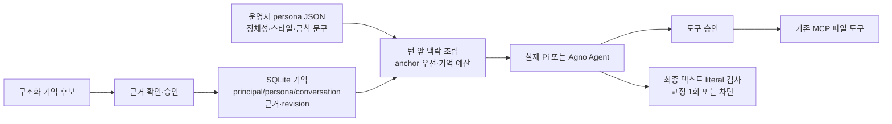

# 기억·페르소나 하네스 조사와 실제 구현·시험

기준일: **2026-11-10**. 작업 위치: **clova-api-lab**.

후속 실제 모델 검사는 [HCX-005 말투·성격 유지 결과](LIVE-PERSONA-RESULTS-2026-11-10.md)에 별도로 기록했다. 아래 48개는 scripted 모델을 사용한 구조 검사이며, 후속 실제 API 결과와 혼합하지 않는다.

## 1. 결과

자매 프로젝트의 기억·페르소나 문서와 공개 하네스들을 조사하고, **Pi + 자체 SQLite 계층**, **Agno + native memory 저장소** 두 가지를 구현했다. 실제 SDK loop·SQLite·MCP 파일 도구를 실행해 **공통 검사 48개(각 24개)**를 통과했다. 최종 결과는 [통합 JSON](runtime/memory-lab/results/comparison.json), 개별 결과는 [Pi](runtime/memory-lab/results/pi.json)·[Agno](runtime/memory-lab/results/agno.json)에 보존한다.

검사에는 저장 후 **새 프로세스**에서 회상, principal/persona/conversation 격리, 승인·거절, 정정·부정·revision, 잊기, 실제 모델 입력 확인, MCP 효과, 페르소나 금칙 문구 교정·차단이 포함된다. 이때 모델 응답은 scripted이고 외부 모델 API 호출은 **0회**다. 기억 저장·주입 구조를 검증한 결과이며, 한국어 사실 추출이나 모델의 말투·성격 유지 능력을 검증한 결과는 아니다.

기존 Elda-CLI 등록·웹 배포·EldaCore 운영 DB는 변경하지 않았다. 자매 문서는 읽기만 했고 코드·패키지·캐시·DB·테스트 산출물은 이 프로젝트 안에만 작성했다.

## 2. 자매 프로젝트에서 확인한 기준

직접 읽은 자료는 Elda-Spec의 persona/memory/harness/brain-gateway 및 Elda-AI-Agent의 Hermes 참고 핸드오프·EldaCore 분석이다. 경로와 근거는 [상세 조사](runtime/memory-lab/research.md)에 있다.

- **페르소나:** 설계자가 정한 정체성이다. 모델을 바꿔도 유지하고, 모델이 기억을 쓰는 경로로 원본을 바꾸지 않는다.
- **기억:** 사람·사건·관계·약속 등을 근거 턴과 함께 저장하는 데이터다. 사용자 주장을 검증된 사실로 자동 승격하지 않는다.
- **기본 범위:** 대화 하나 안이다. 이번에도 session을 기본값으로 두고 long_term은 합성 실험의 명시 옵션으로만 사용했다.
- **접점:** 턴 앞에 persona·회상 맥락을 주입하고, 도구 앞에서 정책을 검사하며, Stop에서 결과를 점검하는 구조다.
- **소유권:** persona는 EldaCore, memory는 EldaCore+DBA 영역이다. 이 실험은 하네스 측 접점의 프로토타입이다.

persona/memory SPEC는 **v0.0 인계 메모**이며 확정 규범이 아니다. 이번 JSON·DB schema를 새 Elda 정식 규격으로 확정한 것은 아니다. SHA-256으로 실험 persona 파일을 식별했으며 정식 배포 artifact의 버전·해시 계약은 별도 정합 작업이 남는다.

## 3. 검색한 공개 방식과 적합성

| 후보 | 기억·페르소나의 구성 | 이번 Elda 관점의 판단 |
|---|---|---|
| **Hermes Agent** | 사용자 소유 SOUL과 학습 USER/MEMORY, 작은 상시 기억·필요 시 원문 검색, write approval | 설계자 anchor와 학습 데이터를 구분하는 좋은 참고. 이번에 Hermes 자체를 설치·실행하지는 않음 |
| **Letta** | persona/human 설정, agent별 MemFS·git 이력, 매턴 회상, dreaming | 지속 정체성·기억 이력 비교에 적합. dreaming의 agent 검토는 사람 승인과 다르며 모델 호출이 추가됨 |
| **Agno** | Agent role/instructions, UserMemory·MemoryManager·DB, 사용자 단위 기억 | native 저장/조회는 바로 활용 가능. Elda의 scope·근거·승인·anchor 불변성은 추가 구성 필요 |
| **LangGraph** | thread checkpoint와 cross-thread store/namespace | 이미 사용하는 그래프에 기억 경계를 붙이기 좋음. 실행 복구와 장기 기억을 구분해야 함 |
| **Deep Agents** | 파일형 기억과 StoreBackend, agent/user namespace | 파일·스킬을 포함한 장기 맥락에 적합. agent 전체 공유와 사용자별 기억을 명시적으로 구분 |
| **Mem0 OSS** | 기억 추출·저장·검색을 교체 가능한 계층으로 제공 | 기존 하네스에 memory adapter로 붙이기 좋음. infer=False라도 embedding 호출이 남을 수 있음 |
| **Graphiti / Zep** | 관계·episode·시간에 따라 바뀌는 사실과 근거 | 관계·약속·정정 이력 확장 후보. Graphiti framework와 관리형 Zep 서비스는 다른 도입 방식 |

공식 근거: [Hermes 파일 소유권](https://github.com/NousResearch/hermes-agent/blob/main/website/docs/user-guide/which-file-does-what.md), [Hermes memory](https://github.com/NousResearch/hermes-agent/blob/main/website/docs/user-guide/features/memory.md), [Letta memory](https://docs.letta.com/configuration/memory), [Letta MemFS](https://docs.letta.com/concepts/memfs), [Agno memory](https://docs.agno.com/memory/overview), [LangGraph memory](https://docs.langchain.com/oss/javascript/langgraph/add-memory), [Deep Agents memory](https://docs.langchain.com/oss/javascript/deepagents/memory), [Mem0 OSS](https://docs.mem0.ai/open-source/python-quickstart), [Mem0 구현](https://github.com/mem0ai/mem0/blob/main/mem0/memory/main.py), [Graphiti](https://github.com/getzep/graphiti).

중요한 구분은 **namespace/ID 필터가 인증을 대신하지 않는다는 점**이다. 이번 CLI의 principal은 운영자가 선택한 격리 키이며 로그인·접근권한 시스템을 구현한 것은 아니다. 또한 작은 기억 저장만 시험하려고 Mem0 기본값을 그대로 실행하면 기본 외부 provider와 프로젝트 밖 저장 경로가 사용될 수 있어, 이번에는 실제 실행하지 않았다. 자세한 문서·코드 차이는 [조사 문서](runtime/memory-lab/research.md)에 남겼다.

## 4. 실제 구현한 두 방식



| 항목 | Pi 방식 | Agno 방식 |
|---|---|---|
| 실제 SDK | Pi agent-core **1.5.1** | Agno **3.1.12** |
| 런타임 | Node **24.15.0** | Python **3.12.3** + Node MCP |
| 기억 저장 | 직접 작성한 node:sqlite schema·transaction | native MemoryManager/UserMemory/SqliteDb에 구조화 payload 저장 |
| 모델/도구 반복 | 실제 Pi Agent·streamFn | 실제 Agno Agent·custom Model |
| persona | 공통 operator JSON anchor | 같은 operator JSON을 native role/instructions에 반영 |
| 회상 | active tuple 결정적 조회·문맥 조립 | native 기억 조회 후 adapter에서 선택·문맥 조립 |
| 추가 정책 | namespace·근거·승인·정정·잊기·출력 검사 | 동일 정책을 native 저장소 밖에서 보완 |
| 자동 추출/embedding | 미구현 | automatic/agentic memory 추출 비활성화 |
| 실제 LLM | scripted 전용 | scripted 전용 |

Pi에 이 SQLite 기억 기능이 기본 내장됐다는 뜻이 아니다. Agno도 저장소를 사용한다고 자동으로 Elda의 모든 기억 규칙을 만족하지 않는다. 자동 memory extraction 및 무제한 native context 삽입은 끄고, 실제 native CRUD와 Agent loop를 사용했다.

구현: [Pi worker](runtime/memory-lab/pi/cli.mjs), [Pi store](runtime/memory-lab/pi/store.mjs), [Agno worker](runtime/memory-lab/agno/cli.py). 세부 역할과 자체 검사: [Pi 메모](runtime/memory-lab/pi/notes.md), [Agno 메모](runtime/memory-lab/agno/notes.md).

## 5. 기억의 실제 동작

### 범위와 재시작

session의 key는 principal + persona + conversation이다. **session이 기본이라는 것은 RAM에만 저장한다는 뜻이 아니다.** 같은 conversation으로 새 프로세스를 실행하면 SQLite에서 기억을 복원한다. 다른 conversation에는 나타나지 않는다.

long_term은 명시 옵션이며 같은 principal/persona의 다른 conversation에서도 회상한다. session과 long_term 저장 공간은 구분한다. 운영 장기 기억 허용이나 자동 학습을 켠 것이 아니다.

### 근거·정정·잊기

- observe는 근거 턴 ID와 본문 digest/pointer를 등록한다. 원문을 별도 transcript DB에 복사하지 않는다.
- remember는 닫힌 tuple을 받는다. kind/slot/thing/value/polarity/evidence_turn_id/observed_at을 검사하고 승인 후 저장한다.
- 같은 값은 중복 저장하지 않으며 값·부정 여부의 변경은 revision을 올린다. 회상에는 active 값만 들어간다.
- 기억은 구조화된 입력과 근거 포인터의 연결이다. 포인터가 있다고 사실의 내용 자체가 참이라고 판정하는 것은 아니다. 자유 한국어에서 tuple을 추출하는 기능은 이번에 구현하지 않았다.
- forget은 해당 기억과 revision을 지우고 다음 모델 입력에 이전 주입·응답이 남지 않게 처리한다. Pi는 기억 변경 시 history를 비우며, Agno도 forget 시 history를 비운다.
- 근거 ID를 다른 본문으로 재사용하지 못하도록 **본문·값 없는 digest/pointer binding은 남긴다**. 이는 회상 대상이 아니다. SQLite 페이지·WAL·백업·이미 생성한 테스트 이벤트 파일까지 물리 삭제했다는 의미는 아니다.

동시 worker가 같은 evidence ID를 다르게 해석하는 경우도 검사했다. Pi는 transaction 안에서 재검증한다. Agno는 승인 후 협조하는 worker 사이의 파일 잠금으로 근거 검사와 native 쓰기를 직렬화한다. 이 결과를 장애 순간의 모든 다중 쓰기에 대한 crash-atomic 보장으로 확대하지 않는다.

## 6. 페르소나에서 실제로 검증한 것

공통 [guide persona](runtime/memory-lab/fixtures/guide.json)와 [reviewer persona](runtime/memory-lab/fixtures/reviewer.json)를 두 구현이 그대로 읽는다. 파일 hash는 유지되며, 학습 기억으로 principal·permissions 같은 필드를 넣어 정책을 바꾸려는 입력은 거부한다.

persona anchor를 우선 넣고 회상 row를 문자 예산 안에서 선택한다. 전체 row가 들어가지 않으면 omittedCount로 알린다. 문자열을 몰래 잘라 저장하지 않는다. **context-chars는 persona+기억 주입의 Unicode 문자 한도이며 전체 모델 토큰 한도가 아니다.** 도구 선언·대화 history·사용자 입력은 별도다.

실제 SDK의 모델 callback이 받은 messages를 `model_context`에 기록하여 올바른 persona와 기억이 전달됐는지 검사했다. 이것은 “모델에게 전달됐다”는 증거이며 “모델이 항상 따랐다”는 증거와 다르다.

최종 텍스트에는 optional forbiddenPhrases 검사를 붙였다. 처음 위반하면 실제 Agent를 한 번 더 호출해 교정시키고, 다시 위반하면 persona_violation으로 차단한다. **정확한 문자열 검사**이며 의미·말투·정체성 일관성을 판정하는 완성된 judge가 아니다. 진단 model_context에는 검사 규칙과 이전 모델 응답이 나타날 수 있으므로 공개 자료에는 합성값만 사용했다.

## 7. 공통 실행 검사 24개

각 항목을 Pi와 Agno에서 실행했다. [공통 runner](runtime/memory-lab/run.mjs)는 실제 저장소와 파일을 확인하며 “기억했다”는 모델 문장만으로 통과시키지 않는다.

| # | 검사 | 판정 근거 |
|---|---|---|
| 1 | 같은 session 재시작 | 새 프로세스의 회상·근거·실제 모델 입력에 값 존재 |
| 2 | 다른 conversation | 기본 session 기억 미노출 |
| 3 | 다른 principal | 다른 사람 기억 미노출 |
| 4 | 다른 persona | 기억 미노출, 올바른 anchor 주입 |
| 5 | long_term opt-in | 명시 옵션일 때만 다른 conversation 회상 |
| 6 | long_term/session 분리 | long_term 기록을 기본 session이 가져오지 않음 |
| 7 | 승인 전 저장·거절 | 다른 프로세스에서도 pending 기록 미노출 |
| 8 | 근거 필수·ID 불변 | 없는 근거 및 같은 ID의 다른 본문 거절 |
| 9 | 동시 evidence 충돌 | 두 worker의 승인 대기 후 충돌 commit 차단 |
| 10 | 정정·중복 | 최신 값·revision 2·반복 저장 idempotence |
| 11 | 잊기 후 재시작 | 회상·모델 입력에서 삭제 값 제외 |
| 12 | 이전 답변의 기억 잔존 | 모델이 값을 한 번 echo한 후에도 forget 다음 입력에서 제외 |
| 13 | 부정으로 정정 | polarity 변경·revision 상승 |
| 14 | 잘못된 승인 | stale/중복 ID·문자열 true 거절 |
| 15 | 기억으로 권한/정체성 변경 | 추가 authority 필드 거절, persona 원본 불변 |
| 16 | 기억 속 승인 우회 문구 | 실제 MCP 쓰기 전에 승인, 거절 시 파일 없음 |
| 17 | 정상 파일 효과 | 승인 후 실제 파일 바이트 확인 |
| 18 | MCP를 통한 다른 사람 파일 접근 | workspace 분리·다른 principal read 실패 |
| 19 | 제한된 주입 문맥 | anchor 유지, 한도 준수, 제외 건수 표시 |
| 20 | persona 1회 교정 | 모델 호출 2회, 교정된 최종 텍스트만 출력 |
| 21 | persona 반복 위반 | 두 번 뒤 차단, 세 번째 응답 사용 안 함 |
| 22 | 승인 대기 중 interrupt | 영속 commit 없음 |
| 23 | 승인 대기 중 EOF | 영속 commit 없음·프로세스 정리 |
| 24 | new | 대화 이력 초기화 후 명시 기억 namespace 유지 |

JSONL 파싱·seq 연속성과 worker/MCP 종료도 검사한다. new는 이 실험에서 history만 지우는 명령이며 새 conversation을 발급하는 Elda 제품 동작과 같다고 간주하지 않는다.

## 8. 실제로 발견해 고친 문제

다음은 프레임워크 전체의 결함이 아니라 **우리 첫 프로토타입의 연결·정책 누락**이다.

1. **Agno 작업장 격리:** 처음에는 같은 DB 옆 workspace를 공유했다. 기억 조회가 분리돼도 MCP로 다른 사람 파일을 읽을 수 있어, namespace별 작업장과 실제 파일 접근 회귀 검사를 추가했다.
2. **Agno forget 후 echo:** 오래된 system 기억만 빼면 이전 assistant 답변의 값이 history에 남았다. forget 시 history를 비우고 모델이 값을 echo하는 fixture로 재검증했다.
3. **동시 근거 충돌:** observe 때 검사해도 사람이 승인하는 동안 다른 worker가 같은 ID에 다른 근거를 저장할 수 있었다. commit 시 재검사·직렬화를 추가했다.
4. **Pi idle 의미:** pending approval의 오류 뒤 idle{busy:true}가 완료처럼 해석될 수 있었다. 활성 작업이 끝났을 때만 idle을 내도록 고쳤다.
5. **Agno context 진단 필드:** 실제 생략은 수행했지만 공통 omittedCount 필드가 없어 검사에 실패했다. 공통 필드로 맞춘 뒤 확인했다.

또한 Agno의 마지막 기억을 지운 뒤에도 근거 ID 불변성이 유지되도록 digest-only ledger를 추가하고 별도 회귀 시험을 실행했다. 본문과 기억 값은 ledger에 저장하지 않는다. 자체 SQL 검사에서는 기억/스키마 버전 테이블만 사용하고 sessions/runs 테이블을 만들지 않은 구성임을 확인했다. 물리 페이지·로그 삭제 보장과는 별개다.

## 9. 장단점과 현재 선택

| 판단 항목 | Pi + 자체 계층 | Agno + native 저장소 |
|---|---|---|
| Elda 닫힌 tuple과 소유권 | schema·transaction·정책을 직접 표현하기 쉬움 | native UserMemory payload에 Elda metadata를 추가해야 함 |
| 기존 TS 하네스와 연결 | 현재 Brain/MCP 계열과 같은 런타임 | Python worker·별도 환경·메시지 변환 필요 |
| 저장 기능 재사용 | DB lifecycle와 migration을 우리가 유지 | native MemoryManager/SqliteDb CRUD 재사용 |
| 정책 책임 | 승인·근거·회상·forget·persona 모두 명시 구현 | native 기능과 별개로 같은 정책 대부분 필요 |
| 확장 방향 | EldaCore memory API를 adapter로 연결하기 좋음 | 향후 native 자동 추출을 별도 조건으로 비교하기 좋음 |

현재는 **Pi를 Elda용 기억·페르소나 접점의 우선 프로토타입**, Agno를 native memory framework와의 비교군으로 두는 판단이 적합하다. Hermes의 소유권 분리와 Letta의 기억 이력은 후속 기능 설계에 참고한다. 관계·시간 그래프가 필요해질 때 Graphiti를 별도 실험으로 늘린다.

공통 persona 파일은 두 구현에서 재사용하지만 **두 SQLite 저장 형식은 서로 직접 호환되지 않는다**. 제품에서는 persona/memory 계약을 하네스 밖에 두고 EldaCore 저장·판정 API를 연결해야 모델·하네스를 바꿔도 기억의 주인이 바뀌지 않는다. 이번에는 운영 DB 없이 그 접점을 로컬로 시험했다.

## 10. 직접 실행과 남은 단계

현재 환경에서 바로 실행한다.

```bash
node runtime/memory-lab/run.mjs
```

설치·선택 실행·산출물 위치는 [README](runtime/memory-lab/README.md)에 있다. 모델 키·Elda 설치본·웹 서버가 필요하지 않다.

아직 실행하지 않은 것은 자유 한국어의 tuple 추출 정확도, 사실/주장/모순의 의미 판정, 한국어 의미 검색, 실제 LLM의 말투·정체성 일관성, 대량·장기간 기억의 유용성, 진행 중 승인/Agent 실행의 장애 후 복원이다. 실모델 단계에서는 같은 persona·같은 근거·같은 과제를 고정하고 비용과 실패를 별도로 측정해야 한다. 운영 인증·DBA migration·실제 Elda-CLI 연결·기존 웹 배포도 별도 작업으로 남는다.
