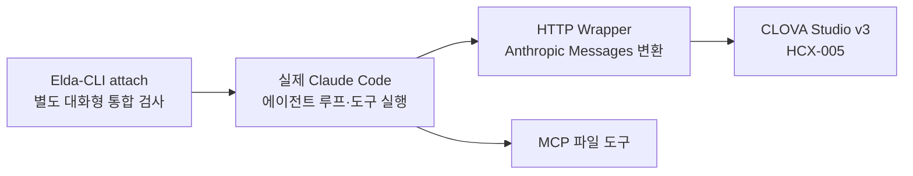
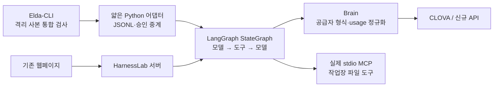

# Elda-CLI용 CLOVA Wrapper 및 모드 ② API 비교 작업 기록

작성 기준: **2026-11-10, Asia/Seoul**
작업 저장소: **`/home/gino/WorkArea/clova-api-lab`**
기존 공개 화면: **<https://elda-ai.org/giants/?view=harness>**

이 문서는 이번 대화에서 진행한 규격 분석, 구현, 실제·모의 검증, 기존 웹페이지 배포, 키 저장 준비와 미완료 사항을 정리한 인수인계 기록이다. 현재 소스, 저장된 JSON 보고서, 앞선 작업의 실행 기록을 대조했다. 문서 작성 자체를 위해 실제 모델 API를 다시 호출하거나 배포를 다시 수행하지는 않았다.

이후 2026-11-11의 기억·페르소나 개선은 [10회차 보고서](PERSONA-POLICY-IMPROVEMENT-2026-11-11.md), 같은 HCX-007의 v8↔v9 추가 시험과 커밋·푸시 검증은 [후속 보고서](PERSONA-CONTINUATION-2026-11-11.md)에 이어 기록한다. 아래 표는 이 문서 작성 시점의 상태다.

**작업 경계:** 이 문서와 관련 문서 수정은 이 저장소 안에서만 수행한다. `reference`는 외부 자료를 가리키는 링크이므로 그 내부를 개발·수정 대상으로 사용하지 않는다. 레퍼런스 원본과 자매 프로젝트에 이번 문서 정리 내용을 쓰지 않는다. 앞서 수행한 CLI 통합 시험 역시 설치본 대신 임시 사본에 패치를 적용했다.

## 1. 현재 상태

| 대상 | 구현·연결 상태 | 실제 API 검증 | 웹에서 직접 실행 |
|---|---|---|---|
| CLOVA ① Claude Code 하네스 | Anthropic 형식 변환 Wrapper로 연결 | 실제 Claude Code print 세션 및 Elda interactive attach에서 각각 검증 | **미구현**. 과거 검증 결과만 표시 |
| CLOVA ② 자체 하네스 | 실제 LangGraph + MCP + Elda 얇은 어댑터 | 직접 그래프, 격리 Elda-CLI 사본, 배포 웹에서 검증 | 가능. 웹은 그래프를 직접 실행 |
| CLOVA ③ 서빙 정책 | 같은 그래프에 무승인 정책 적용 | 격리 Elda-CLI 사본과 배포 웹 등에서 검증 | 가능. 전체 운영 serve-gate 완성을 뜻하지 않음 |
| Groq ② | 공급자 어댑터·CLI 비교기·웹 선택 연결 | **미실시**. 실제 Elda-CLI 경유 모의 API 시험 통과 | 선택 가능, 실제 키 미등록으로 실호출 차단 |
| OpenRouter ② | 위와 같음 | **미실시**, 모의 시험 통과 | 위와 같음 |
| Z.ai ② | 위와 같음. 중국 LLM 포함 | **미실시**, 모의 시험 통과 | 위와 같음 |
| 신규 공급자 키 | 로컬·배포 서버 저장 경로와 숨김 입력 도구 준비 | **실제 키 발급·저장 미완료** | 등록 여부를 표시 |
| EldaCore 전체 | 이번 저장소의 담당 범위 아님 | 해당 없음 | 해당 없음 |
| 설치된 Elda-CLI에 정식 등록 | 어댑터와 등록 patch 제공 | 사본 통합 시험 완료 | **설치본 변경·정식 배포는 하지 않음** |

가장 중요한 구분은 다음과 같다.

- **실제 CLOVA 호출 성공**과 **신규 세 공급자의 모의 API 성공**은 다른 결과다.
- **웹에서 LangGraph를 실행한 검사**와 **실제 Elda-CLI 프로세스를 거친 검사**는 다른 경로다.
- **키 파일을 읽을 수 있음**과 **공급자 인증 성공**, **과제 성공**은 각각 다른 상태다.
- **기존 CLOVA의 ①·②·③ 작업 이력**은 유지한다. 사용자가 “이건 2번만 하자”라고 좁힌 범위는 새 API 비교다.
- 현재 결과는 한정된 파일 과제의 기능 검사다. 일반적인 모델 품질 순위나 모든 Elda-Spec 항목의 적합 인증은 아니다.

## 2. 요구사항과 확정된 범위

| 요청·결정 | 작업에 반영한 내용 |
|---|---|
| 루트의 reference 안 Elda-Spec 상세 분석 | MCP, 하네스, 기록, 두뇌 관문 책임을 구분하고 구현 기준 확인 |
| 자매 Elda-AI-Agent 분석 | 폐기된 CLI 사본과 실제 Elda-CLI 실행본 구분, 기존 서빙 구조 확인 |
| 담당은 Elda-CLI가 사용할 CLOVA Wrapper | 모델 호출·형식 변환·도구 연결과 비교 하네스에 집중 |
| 무료 크레딧을 사용한 유료 API 시험 허용 | 실제 CLOVA HCX-005 호출과 파일 결과 검증 수행 |
| ①·②·③ 비교 | ① native Claude Code, ② 자체 승인 하네스, ③ 같은 하네스의 무승인 정책으로 분리 |
| ①도 연결 실체가 필요 | 실제 Claude Code 실행과 실제 Elda attach를 별도 검증 |
| 기존 배포 웹페이지에서 테스트 | `/giants/?view=harness`에 세션·승인·결과 파일 UI 배포 |
| 중국을 포함한 추가 공개·무료 API 조사 | 중국 제외 조건을 두지 않고 후보 검토, Z.ai 포함 |
| 새 API는 ②만 | 신규 세 공급자의 웹·비교 실행기를 ② 대상으로 구현 |
| 새 API 키는 아직 없음 | 키 없는 상태를 미실시로 기록하고 저장 도구·경로만 준비 |
| 멀티 에이전트 활용 | 공급자 변환, 실제 CLI 비교기, 웹 서비스·검증을 병렬 작업 후 통합 |
| 문서는 이 프로젝트 폴더에서만 작성 | 이 파일과 자체 README에만 기록. reference 내부 수정 금지 |

초기 설명에서는 CLI 연결, 자체 하네스, 웹에서 가능한 모드의 구분이 충분하지 않았다. 후속 작업에서 각각을 별도 검증하고 표시하도록 정리했다. 특히 **웹 ① 실행은 여전히 없다**는 점을 완료 범위에 포함시키지 않는다.

## 3. 분석한 규격과 프로젝트 책임

### 3.1 분석 기준

| 자료 | 분석 기준 | 해석 |
|---|---|---|
| Elda-Spec | `8bcf06c` | 규격 기준 저장소 |
| Elda-Spec `harness/SPEC.md` | v0.7 초안 | 실행기·이벤트·승인·수명·격리 책임 참고 |
| Elda-Spec `mcp-wrapper/SPEC.md` | v1.1 | MCP Wrapper, 도구, batch, 경로·오류 계약 참고 |
| Elda-Spec `records/SPEC.md` | v0.1 초안 | 기록·비밀 가리기·보존 책임 참고 |
| Elda-AI-Agent | `02e8af0` | 자매 프로젝트 구조와 모드 흐름 분석 |
| 실제 Elda-CLI | `4f6d90e151bf5025a82f97c7ee73d672214546fa` | 격리 사본 통합 시험의 원본 |

이 커밋들은 이번 작업에서 분석·검증한 기준이다. 앞으로 해당 저장소의 HEAD가 바뀌면 동일한 결과를 자동으로 보장하지 않는다.

### 3.2 자매 프로젝트에서 확인한 사항

- `Elda-AI-Agent/cli-wrapper/`는 폐기된 전신이다. 이번 연결의 실제 소비자는 별도 Elda-CLI다.
- 이 환경의 기준 실행본은 `/home/gino/apps/elda-cli/elda`다. PATH에 남은 오래된 `elda`와 구분했다.
- CLI의 `events.py`, 어댑터, 공급자, MCP 클라이언트 구조를 확인했다.
- 자매 프로젝트에는 mini-api, workspace, serve-gate, Runtime, 기록 영역이 있다.
- 기존 서빙 경로 `serve-gate → Elda-CLI → vector-mcp → VectorCraft`는 분석한 기존 구조다. 이번 저장소에서 그 전체를 새로 구현한 것은 아니다.
- 자매 모드 문서에는 ②의 보류·미개발 표기도 있다. 이번 비교 하네스를 만들었다고 워크스페이스·봇 등 제품 전체가 완성된 것은 아니다.
- EldaCore는 두뇌 관문·모델 라우팅·페르소나·학습 등의 별도 소유 영역이다. 여기의 `Brain` 클래스는 공급자 호출 어댑터이며 EldaCore 전체 구현이 아니다.

### 3.3 네이버 하네스에 대한 판단

당시 공식 문서 조사에서는 CLOVA Studio의 Function calling, 호환 API, LangChain/LangGraph 연동 자료를 확인했다. Claude Code처럼 설치해서 곧바로 사용하는 완성된 네이버 공식 에이전트 하네스는 확인하지 못했다. 따라서 자체 하네스를 만들었으며 이를 네이버 공식 하네스로 부르지 않는다.

①은 Claude Code라는 외부 하네스의 모델 호출을 CLOVA로 연결하는 호환 실험이다. 비-Claude 모델 연결의 공식 보장이나 전체 Claude 기능 호환을 주장하지 않는다.

기존 조사·구현 참고 링크:

- [CLOVA Studio Function calling](https://api.ncloud-docs.com/docs/en/clovastudio-chatcompletionsv3-fc)
- [네이버 LangChain/LangGraph 연동](https://guide.ncloud-docs.com/docs/en/clovastudio-dev-langchain)
- [Claude Code LLM gateway](https://code.claude.com/docs/en/llm-gateway)

## 4. 세 모드의 실제 실행 구조

### 4.1 ①: Claude Code 하네스의 모델을 CLOVA에 연결



- Claude Code가 프롬프트 구성, 모델과 도구 사이의 반복, 도구 실행을 담당한다.
- Wrapper는 요청·응답 형식을 변환한다. Wrapper 내부에서 별도의 에이전트 루프를 돌리지 않는다.
- 이때 실제 추론 모델은 CLOVA다. Claude 모델이 `clova_chat`을 호출하는 방식과 구분한다.
- native print 세션 비교와 Elda interactive attach는 서로 별도 시험이다.
- 원본 CLOVA 키는 Wrapper가 보유하고, Claude Code에는 별도의 Wrapper 접속 토큰만 전달한다.
- 웹에서 이 native 세션을 생성·조작하는 기능은 구현하지 않았다.

### 4.2 ②·③: 자체 LangGraph 하네스



| 항목 | ② | ③ |
|---|---|---|
| 하네스 구현 | 자체 LangGraph | 같은 LangGraph |
| 도구 승인 | 실행 전에 승인 요청 | 승인 질문 없이 정책으로 실행 |
| Elda-CLI 옵션 | `--approve ask` | `--approve auto` |
| 그래프 자식 옵션 | `--approve ask` | `--approve never` |
| CLOVA 검증 | 실제 API 완료 | 실제 API 완료 |
| 신규 API의 이번 지원 범위 | 포함 | 제외 |

웹은 위 그림의 `HarnessLab → LangGraph` 경로를 사용한다. **웹 요청이 Elda-CLI를 경유하지 않는다.** Elda-CLI 실제 연결은 별도 비교 실행기가 검증한다.

신규 공급자의 ② 제한은 웹 서비스에서 검사하고, 전용 비교기는 항상 `ask`로 실행한다. 저수준 `Brain`이나 그래프 클래스 전체가 모델과 승인 정책의 조합을 전역적으로 금지하는 구조는 아니다. HTTP Wrapper는 여전히 CLOVA 전용이며 신규 공급자를 ①에 추가하지 않았다.

## 5. 구현 파일과 책임

경로는 저장소 루트 기준이다.

| 파일 | 구현 내용 |
|---|---|
| [common.ts](runtime/clova/common.ts) | 메시지·도구·usage 타입, 오류, 키 파일 권한 검사, 비밀 가리기, 작업장 경로 검사 |
| [provider.ts](runtime/clova/provider.ts) | CLOVA v3 호출, 대본 모드, 신규 공급자 디스패치 |
| [providers.ts](runtime/clova/providers.ts) | 신규 공급자·고정 모델·공식 주소·키 환경변수·지원 모드 목록 |
| [openai-provider.ts](runtime/clova/openai-provider.ts) | Groq/OpenRouter/Z.ai 요청·응답 변환, reasoning 보존, usage 정규화 |
| [http.ts](runtime/clova/http.ts) | 인증된 CLOVA HTTP Wrapper, OpenAI/Anthropic 입구 |
| [anthropic.ts](runtime/clova/anthropic.ts) | Anthropic 텍스트·도구 호출·결과·SSE 형식 변환 |
| [mcp.ts](runtime/clova/mcp.ts) | stdio MCP 서버, 파일 도구, 단발성 생성, batch |
| [client.ts](runtime/clova/client.ts) | 실제 MCP 자식 생성·초기화·호출·종료와 환경 격리 |
| [langgraph.ts](runtime/clova/langgraph.ts) | 현재 자체 하네스, 승인·상태·한도·훅·중단·기록 |
| [harness.ts](runtime/clova/harness.ts), [live.ts](runtime/clova/live.ts) | 먼저 만든 독립 루프와 그 실API 검사. 현재 웹 엔진은 아님 |
| [claude-probe.ts](runtime/clova/claude-probe.ts) | 실제 Claude Code print 세션 비교 |
| [graph-probe.ts](runtime/clova/graph-probe.ts) | LangGraph 직접 ②·③ 비교 |
| [compare.ts](runtime/clova/compare.ts) | 기존 CLOVA 세 모드 비교 실행·보고서 |
| [claude-attach-live.ts](runtime/clova/test/claude-attach-live.ts) | 실제 대화형 Claude Code + Elda attach 실API 검사 |
| [elda-graph-live.ts](runtime/clova/elda-graph-live.ts) | 실제 Elda-CLI 사본 → 그래프의 CLOVA ②·③ 검사 |
| [mode2-compare.ts](runtime/clova/mode2-compare.ts) | 신규 API ② 전용 실제 CLI 경유 모의/실API 검사 |
| [elda_clova.py](runtime/clova/integration/elda_clova.py) | 모델 루프 없는 JSONL 중계 어댑터 |
| [elda-cli-register.patch](runtime/clova/integration/elda-cli-register.patch) | 검토용 CLI 사본에 `clova` 에이전트 등록 |
| [configure-provider.py](runtime/clova/integration/configure-provider.py) | 발급된 키의 숨김 입력·비공개 저장·상태 조회 |
| [service.ts](server/harness/service.ts) | 웹 세션, 작업장, 그래프 프로세스, 승인·조회·삭제 |
| [harness.ts 라우트](server/routes/harness.ts) | 인증된 `/api/harness` HTTP API |
| [harnessClient.ts](src/api/harnessClient.ts) | 웹 API 호출, 접속 코드·클라이언트·세션 식별자 관리 |
| [HarnessView.tsx](src/components/harness/HarnessView.tsx) | 공급자·모드 선택, 요청·승인·파일·기록 UI |
| [ComparisonResults.tsx](src/components/harness/ComparisonResults.tsx) | 기존 CLOVA 세 모드 검증 기록 표시 |
| [Mode2Results.tsx](src/components/harness/Mode2Results.tsx) | 신규 세 공급자 모의/실제 미실시 기록 표시 |

`server/index.ts`, `src/App.tsx`, `src/components/Layout.tsx`, `src/store/useClovaStore.ts`에는 기존 앱 안의 라우트·화면 진입점을 연결했다. `package.json`과 lock 파일에는 실행·검사·번들 명령과 LangGraph 의존성을 반영했다.

### 5.1 CLOVA 공급자와 HTTP Wrapper

- CLOVA native 경로: `/v3/chat-completions/{model}`. Bearer 키 파일을 사용한다.
- Function calling의 도구 스키마, 호출 ID, `toolCallId`, 인자, 종료 이유, usage를 전달한다.
- 네이티브 인자가 JSON 문자열이면 파싱한다. 실제 관측한 `arguments:null`은 빈 객체로 정규화하여 MCP 필수 인자 검사에서 수정 가능한 오류가 되게 했다.
- 잘못된 ID, 중복 ID, 잘못된 인자 구조는 거절한다.
- 기본 출력 상한 2,048토큰, temperature 0, 개별 HTTP 요청 제한 60초다. Function calling에서 1,024 미만 출력 한도는 거절한다.
- transport 자체는 자동 재시도하지 않는다. 그래프의 제한된 재시도 정책은 별도다.
- Wrapper 입구는 `/v1/models`, `/v1/chat/completions`, `/v1/messages`다. Anthropic의 beta query를 처리한다.
- Wrapper 접속 토큰과 CLOVA API 키가 같으면 거절한다. 기본 standalone 바인드는 loopback이다.
- OpenAI 경로는 현재 `stream:false`만 지원한다.
- Anthropic SSE는 대기 ping 후 완성 응답을 순서대로 전달한다. `buffered-native`이며 실시간 토큰 스트리밍·TTFT 측정으로 해석하지 않는다.
- 지원하지 않는 thinking/cache/effort 등 입력은 무시하지 않고 거절한다. native Claude 검사에서는 관련 기능을 껐다.

### 5.2 MCP 파일 도구

| 도구 | 구현·제한 |
|---|---|
| `api_version` | API 버전 `1.0.0` |
| `artifact_list` | 작업장 최상위 파일 목록 |
| `artifact_read` | UTF-8 읽기, 최대 1 MiB |
| `artifact_write` | 최대 100,000자, 임시 파일 + rename. 부모 폴더는 이미 존재해야 함 |
| `artifact_undo` | 최근 쓰기 복원, 프로세스 안 undo 이력 최대 40개 |
| `clova_chat` | 별도 단발성 모델 생성. 에이전트 하네스가 아님 |
| `batch` | 최대 40단계, 이름 참조, 실패 단계에서 정지하고 부분 결과 반환 |

기본 비교·웹 프로필은 네 파일 도구만 노출한다. `clova_chat`은 그래프에서 제외하여 모델이 다시 모델을 도구로 호출하는 중첩 실행을 피한다. 제한 프로필에서는 batch/lean을 통한 allowlist 우회도 막는다.

경로 이탈과 심볼릭 링크 이탈을 검사한다. 동일한 내용을 다시 쓰는 요청은 undo 이력을 추가하지 않는다. 비교 프로필은 undo 보관 개수와 별도로 **턴당 실행 1회**를 설정한다. 파일 경로 검사는 OS 샌드박스나 외부 프로그램의 모든 권한 제한을 뜻하지 않는다.

### 5.3 LangGraph 상태·승인·오류·기록

- 실제 `@langchain/langgraph`의 `StateGraph`로 모델 → 도구 → 모델 전이를 구성한다.
- 입력은 `prompt`, `new`, `notify`, `approve`, `interrupt`와 EOF다. 출력은 `{v, seq, ts, t, data}` JSONL이다.
- 주요 출력에는 `ready`, 텍스트, 도구 호출·결과, 승인, 오류, `turn_end`, `idle`이 있다.
- `ask`에서는 승인 전 파일 부작용이 발생하지 않는다. 승인 거절·승인 대기 중단을 처리한다.
- 일반 그래프 기본값은 12왕복·300초다. **비교기와 웹 프로필**이 4왕복·120초로 줄인다.
- 도구 실행 전 429/500/502/503/529 오류에 한 번 재시도할 수 있다. 도구 실행 후 동일 작업을 무조건 재시도하지 않는다.
- 그래프가 집계하는 모델 라운드와 실제 HTTP 시도 수는 같지 않을 수 있다. usage 없이 실패한 요청의 재시도는 별도 시도이므로, 4라운드 설정을 모든 경우에 HTTP 요청 총 4건이라는 의미로 해석하지 않는다.
- 출력 잘림, 시간 초과, 허용되지 않은 도구, 도구별 실행 상한을 구분한다.
- 도구 실행 후 상태가 불확실한 실패는 세션을 재시작해야 하는 상태로 처리한다.
- 그래프의 EOF는 진행 중 턴 종료를 기다리되 승인 대기는 거절한다. 초기 독립 루프와 EOF 동작을 혼동하지 않는다.
- `--records` 지정 시 비밀을 가린 이벤트 JSONL과 요약을 남긴다. 시작 시 90일이 지난 JSONL을 정리한다.
- `maxBudgetUsd`는 명시적 단가가 함께 제공될 때만 비용 상한으로 사용한다. 기본 웹 한도는 시간·턴·토큰 제한이며 청구액 상한 보장은 아니다.

훅은 `UserPromptSubmit`, `PreToolUse`, `PostToolUse`, `PostToolUseFailure`, `Stop`을 지원한다. 현재 그래프에서 `deny/defer`는 거절하고, `ask`는 ②에서 승인 대기를 만든다. 무승인 정책에서 훅이 `ask`를 요구하면 거절한다. Stop 차단은 한 번 보정 후 다시 차단되면 실패하며 최종 텍스트는 Stop 통과 후 전달한다. 전체 Claude 훅 API 구현은 아니다.

### 5.4 Elda-CLI 어댑터

- 모델·도구 루프는 자식 LangGraph에만 있다. 어댑터는 JSONL과 승인 결정을 중계한다.
- 바깥 CLI가 `ready/idle`을 내므로 자식 이벤트를 그대로 중복 표시하지 않는다.
- 합본 텍스트만 중계하여 delta와 완성 텍스트의 중복을 피한다.
- 선택한 모델 접두어에 해당하는 키 파일 경로만 전달한다. 다른 공급자 키는 자식 환경에 넣지 않는다.
- MCP 자식에는 공급자 키를 자동 전달하지 않는다.
- 새 모델을 연결해도 어댑터 등록 ID와 일부 클래스·환경변수 이름은 `clova`/`ELDA_CLOVA_*`를 유지한다. 실제 공급자는 모델 selector가 결정한다.
- 통합 검사는 원본 CLI를 복사하고 patch와 어댑터를 적용한다. 원본 해시가 바뀌지 않았는지도 확인한다.

## 6. 추가 API 조사와 ② 연결

추가 조사에는 중국 모델도 포함했다. 글로벌 API, 중국 API, 여러 모델을 제공하는 중계 서비스의 무료·시험 조건과 도구 호출 적합성을 검토한 뒤 아래 세 후보를 먼저 연결했다. 이번 단계에서는 신규 계정 가입·키 발급·공급자 인증 성공을 확인하지 못했다.

대화에서 검토한 더 넓은 후보에는 Google Gemini, Cloudflare Workers AI, ModelScope, Alibaba 계열, NVIDIA NIM, Hugging Face, Mistral, Cerebras, SambaNova, GitHub Models 등이 있었다. 상시 무료 할당량, 신규 가입 체험 크레딧, 결제 정보 요구, 계정별 조건, 서비스·모델 제공 중단 여부를 구분하는 것이 조사 기준이었다. 이 후보들을 모두 연결하거나 호출한 것은 아니며, 당시 정책 수치를 현재의 확정 사용 조건으로 재게시하지 않는다. 이번 구현 대상은 아래 세 개이고 기존 Chat/Bench 전체의 공급자 확장과도 구분한다.

| 공급자 | 고정 selector | 기본 주소 | 키 파일 환경변수 |
|---|---|---|---|
| Groq | `groq:openai/gpt-oss-120b` | `https://api.groq.com/openai/v1` | `GROQ_API_KEY_FILE` |
| OpenRouter | `openrouter:cohere/north-mini-code:free` | `https://openrouter.ai/api/v1` | `OPENROUTER_API_KEY_FILE` |
| Z.ai | `zai:glm-4.7-flash` | `https://api.z.ai/api/paas/v4` | `ZAI_API_KEY_FILE` |

구현 정책:

- 후보 selector는 allowlist로 고정한다. 브라우저가 임의 모델·공급자 URL·키 파일을 지정하지 못한다.
- 기본 공식 HTTPS 주소를 사용한다. 신규 `*_BASE_URL` 재정의는 loopback 시험 서버만 허용한다. 운영에서 공식 주소를 같은 환경변수에 다시 넣을 필요도 없다.
- OpenAI Chat Completions의 메시지, `tool_calls`, JSON 인자, `tool_call_id`, 종료 이유를 공통 형식으로 변환한다.
- reasoning 관련 메타데이터는 필요한 다음 요청에 보존하되 일반 답변과 구분한다.
- Groq GPT-OSS에는 `max_completion_tokens`, `reasoning_effort:low`, `include_reasoning:true`를 사용한다.
- Z.ai에는 `thinking:{type:"disabled"}`를 지정한다.
- OpenRouter는 `:free` 고정 모델, `require_parameters:true`, `allow_fallbacks:false`, 입력·출력·요청 가격 상한 0을 지정한다.
- usage는 `input/output/cacheRead/cacheWrite` 네 구간으로 정규화한다. prompt 합계에서 cache read/write를 분리하고 reasoning 토큰을 출력에 다시 더하지 않는다.
- HTTP 오류·redirect·취소·본문 수신 지연을 처리하고 공급자 오류 원문의 비밀값은 전달하지 않는다.

Groq의 무료 사용 여부는 계정 요금제·할당량에 따른다. OpenRouter의 무료 모델과 Z.ai 후보도 실제 제공 여부·계정 조건을 실호출 전에 다시 확인해야 한다. **무료 후보로 선정했다는 사실을, 현재 계정에서 비용 없이 사용 가능하다는 실측 결과로 기록하지 않는다.**

기존 구현 참고 링크: [Groq reasoning](https://console.groq.com/docs/reasoning), [OpenRouter provider selection](https://openrouter.ai/docs/guides/routing/provider-selection), [OpenRouter reasoning 보존](https://openrouter.ai/docs/guides/best-practices/reasoning-tokens), [Z.ai GLM-4.7](https://docs.z.ai/guides/llm/glm-4.7).

## 7. 공통 비교 과제와 성공 판정

기준 파일: [fixtures/comparison.json](runtime/clova/fixtures/comparison.json)
과제 ID: `clova-harness-file-v2`
결과 파일: `comparison.txt`

| 단계 | 요구되는 실제 동작 | 정확한 결과 |
|---|---|---|
| 생성 | `artifact_write` 정확히 한 번 | `CLOVA 비교 시험 — 처음 내용` |
| 수정 | 같은 파일에 `artifact_write` 정확히 한 번 | `CLOVA 비교 시험 — 수정 내용` |
| 되돌리기 | `artifact_undo` 한 번 후 `artifact_read`; write로 재생성 금지 | 다시 `CLOVA 비교 시험 — 처음 내용` |

문자열 뒤에 마침표·개행을 추가하지 않는다. 프롬프트에 JSON 문자열 표기를 사용해 저장할 바이트를 분명히 했다. 신규 공급자 시험도 기존 과제와 같은 내용을 사용하므로 파일 내용에 CLOVA라는 이름이 남아 있다. 이는 실제 사용 모델 표시가 아니다.

공통 시스템 지시문:

> 파일 작업은 주어진 도구로 수행하세요. 요청한 내용만 정확히 저장하세요. 도구 결과를 보고 완료를 판단하세요. 성공한 수정이나 되돌리기를 반복하지 마세요.

현재 비교 조건은 temperature 0, 최대 출력 2,048토큰, 사용자 요청당 최대 4 모델 왕복·120초, 네 파일 도구다. 하네스가 덧붙이는 설명과 도구 접두어, native Claude의 max-turns 의미는 같지 않다.

성공 판정은 모델이 “완료”라고 말했는지만 보지 않는다. 실제 파일 내용, 필요한 도구의 성공, undo 횟수, undo 후 read, 같은 대화 유지, 한도, 승인 전 부작용 없음, 종료 후 프로세스 정리를 함께 확인한다. 자동 시험 제어기는 격리된 공통 파일 도구만 승인하며 웹에서는 사용자가 승인한다.

## 8. 실제·모의 검증 결과

### 8.1 초기 독립 루프와 초기 웹

이 단계는 최종 LangGraph 비교 이전의 이력이다.

| 검사 | 결과 | usage·범위 | 근거 |
|---|---|---|---|
| 초기 독립 루프 최종 실API | 4/4 통과 | MCP 단일 생성 + 파일 생성/읽기·수정·undo/읽기; 입력 3,164 / 출력 336 | `runtime/clova/results.local/final/report.json` |
| 위 시험의 실패 분석 포함 3회 실행 | 최종 성공 | 입력 합계 8,586 / 출력 합계 977 | `runtime/clova/results.local/summary.json` |
| 초기 배포 웹 실API | 파일 과제·다운로드 성공 | 모델 8회 / 도구 8회, 입력 3,682 / 출력 588, JS 오류 0 | `runtime/clova/results.local/deployed-web/` |

이 수치는 다음 LangGraph 시험의 사용량과 합치거나 교체하지 않는다. 전체 계정 청구액·이번 작업 전체의 사용량 합계도 아니다.

### 8.2 CLOVA 세 하네스 직접 비교 — 실제 API

공개 근거: [comparison-report.json](public/comparison-report.json). 기록 시각 `2026-11-10T06:01:52.829Z`.

| 경로 | 파일 과제 | 모델 / 도구 | 승인 | 입력 / 출력 토큰 | 전체 시간 |
|---|---|---|---|---|---|
| ① 실제 Claude Code print 세션 | 3/3 통과 | 6 / 4 | 시험 프로필의 대화형 승인 0 | 2,083 / 187 | 11,734 ms |
| ② LangGraph 직접 | 3/3 통과 | 6 / 4 | 4 | 2,335 / 157 | 12,212 ms |
| ③ LangGraph 직접 | 3/3 통과 | 6 / 4 | 0 | 2,335 / 157 | 12,458 ms |

시간은 도구·프로세스 처리가 포함된 한 번의 기능 검사 측정값이다. 반복 성능 벤치마크나 모델 순위로 사용하지 않는다. ① print 검사의 승인 0은 아래 대화형 attach의 TTY 승인 절차와 다른 항목이다.

### 8.3 실제 Elda-CLI 연결 — 실제 CLOVA API

| 검사 | 결과 | 관측값·중요 확인 |
|---|---|---|
| ① Elda interactive attach | 통과 | 실제 대화형 Claude Code, private tmux, TTY API 승인, 모델 6회, 입력 2,077 / 출력 177 |
| ① 관찰자 종료 계약 | 통과 | Elda 관찰자 EOF 후 native 엔진 생존, 시험 종료 후 private tmux와 잔존 프로세스 정리 |
| ② Elda 사본 → 어댑터 → LangGraph | 3턴 통과 | 6왕복, 도구 4회, 승인 4회, 입력 2,335 / 출력 157 |
| ③ Elda 사본 → 어댑터 → LangGraph | 3턴 통과 | 6왕복, 도구 4회, 승인 0회, 입력 2,335 / 출력 157 |
| 설치 CLI 보존 | 통과 | 원본 해시 불변, 테스트용 사본에만 등록 patch 적용 |

근거: `runtime/clova/comparison-attach-live.local/report.json`, `runtime/clova/comparison-elda-live.local/report.json` 및 공개 보고서의 `integration` 항목.

### 8.4 최종 LangGraph 웹 — 실제 CLOVA API

공개 보고서의 `integration.deployedWeb` 기록 시각은 `2026-11-10T06:11:54.839Z`다.

| 웹 모드 | 파일 과제 | 모델 / 도구 | 승인 | 입력 / 출력 | 브라우저 오류 |
|---|---|---|---|---|---|
| CLOVA ② | 3/3 통과 | 6 / 4 | 4 | 2,335 / 157 | 0 |
| CLOVA ③ | 3/3 통과 | 6 / 4 | 0 | 2,335 / 157 | 0 |

웹 시스템 지시문을 공통 fixture에서 읽도록 맞춘 뒤 다시 검사한 결과다. 웹은 그래프 직접 실행이며 이 표만으로 Elda-CLI 경유를 주장하지 않는다.

### 8.5 신규 세 공급자 ② — 모의 API

공개 근거: [mode2-comparison-report.json](public/mode2-comparison-report.json). 기록 시각 `2026-11-10T06:55:52.667Z`.

| 공급자 | 실행 경로 | 파일 과제 | 모의 모델 왕복 / 도구 / 승인 | 실제 API |
|---|---|---|---|---|
| Groq | 실제 Elda 사본 → 어댑터 → LangGraph → 로컬 HTTP 모의 API + 실제 MCP | 3/3 | 7 / 4 / 4 | 미실시 |
| OpenRouter | 위와 같음 | 3/3 | 7 / 4 / 4 | 미실시 |
| Z.ai | 위와 같음 | 3/3 | 7 / 4 / 4 | 미실시 |

세 공급자 모두 `mock_passed`다. 승인 전 파일 상태, 하나의 세션 유지, 선택 공급자 키만 그래프에 전달, MCP 키 미전달, JSONL 출력, 정상 종료, 프로세스 정리를 확인했다.

이 모의 API는 결정된 도구 응답을 돌려준다. usage는 `synthetic`이며 모델의 추론 성능이나 지시 준수를 검증한 결과가 아니다. 모의 API가 undo와 read를 별도 모델 응답으로 내므로 기존 CLOVA 실API의 6회와 달리 7회다. 이 차이로 공급자 성능을 비교하면 안 된다.

별도 `--live` 실행에서 키가 없는 세 항목은 모두 `not_configured`, `pass:false`, 과제 0개, 사용량 0으로 기록했다. 실제 CLI·공급자 호출 경로에 들어가기 전에 건너뛰었다. 신규 공급자 실제 추론 요청은 **0회**다.

원본 보고서의 `inference:"live"`는 요청한 실행 방식을 나타내므로, 그 필드만으로 실제 호출 여부를 판단하지 않는다. 반대로 mock 보고서의 `allConfigured:true`는 로컬 시험용 자격증명이 준비됐다는 의미이며 실제 계정 키가 있다는 뜻이 아니다. `sharedFixtureSourceModel:"HCX-005"`는 과제의 출처 메타데이터이고 실제 후보 모델은 `results[].model`에 기록한다.

### 8.6 신규 기능의 로컬·배포 브라우저 검사

- 기본 Groq·② 선택, 세 공급자 미등록 표시, 실호출 버튼 비활성화, 신규 ③ 선택 차단 확인.
- 모의 3건 통과와 실제 3건 미실시를 별도 표시하는지 확인.
- 로컬 모의 HTTP 공급자에서는 키 등록 상태, 도구 승인, 실제 파일 생성, 세션 새로고침 복구를 확인.
- 공개 사이트에서는 실제 공급자 호출을 막고 `scripted` 생성만 허용하여 무료 연결 검사를 수행.
- 데스크톱 및 최종 320px 모바일에서 실행 → 승인 1회 → 응답 완료 → 세션 삭제 통과.
- 선택 상자의 가로 넘침과 실행 버튼 겹침을 수정한 뒤 재배포·재검사.
- 최종 공개 검사에서 페이지 오류 0건, 실제 모델 API 호출 0회.
- 별도 공개 API 검사에서 신규 각 공급자의 키 미등록 ② 요청은 503, ③ 요청은 400으로 거절됨을 확인.

근거: `runtime/clova/browser.local/mode2-results/report.json`, `runtime/clova/browser.local/mode2-deployed-results/report.json`, 같은 폴더의 `mobile-final.json`과 스크린샷.

### 8.7 자동 검사 실행 기록의 정확한 범위

| 검사 묶음 | 확인된 실행 기록 | 해석 |
|---|---|---|
| 런타임 전체 회귀 | 당시 53/53 통과 | 뒤에 추가된 두 테스트까지 포함한 최신 전체 재실행 결과로 부르지 않음 |
| 신규 공급자 어댑터 | 마지막 cache-write 보완 후 7/7 통과 | 세 공급자 다중턴·usage·오류·취소 등 |
| 신규 CLI 비교기 + 기존 어댑터 | 당시 8/8 통과 | 실제 CLI를 사용한 모의 통합 포함 |
| 마지막 credential 분류 수정 | 관련 4/4 통과 | 경로 미설정·파일 없음·빈 파일·권한 오류 |
| 웹 서비스 | 6/6 통과 | 기존 CLOVA와 신규 공급자, 승인·거절·중단·격리 |
| Python 키 저장 도구 | 2/2 통과 | 권한·비밀 미출력·기존 키 보존·링크/비TTY 거절 |
| TypeScript 검사 | 최종 수정 후 통과 | `check:clova-runtime`, 프런트 빌드의 타입 검사 |
| 프런트·서버 번들 | 최종 배포본 빌드 성공 | Node 20용 서버/실행기 번들 포함 |

현재 소스의 런타임 테스트 정의는 55개다. **현재 55개 전체를 한 번에 실행해 모두 통과했다는 새 기록은 만들지 않았다.** 위 숫자는 겹치는 검사를 포함하므로 합산하여 독립 테스트 총수로 쓰지 않는다. 이번 문서 정리에서는 테스트를 재실행하지 않았다.

현재 테스트 파일별 구성은 다음과 같다. 이 표의 개수는 소스의 정의 수이며 별도 실행 결과가 아니다.

| 파일 | 정의 수 | 주요 검증 대상 |
|---|---|---|
| `runtime/clova/test/runtime.test.ts` | 8 | 파일 원자성·경로·batch·native v3·독립 루프·훅·재시도·비용·마스킹·undo·null 인자 |
| `runtime/clova/test/http.test.ts` | 8 | Wrapper 인증·OpenAI 변환·요청 크기·주입 거절·오류·취소·loopback |
| `runtime/clova/test/anthropic.test.ts` | 8 | Anthropic 블록·도구 ID·SSE·미지원 기능·오류·취소·출력 한도 |
| `runtime/clova/test/mcp-api.test.ts` | 1 | 실제 stdio MCP와 로컬 HTTP 공급자 |
| `runtime/clova/test/langgraph.test.ts` | 7 | 승인·거절·서빙·취소·한도·EOF·notify·재시도 |
| `runtime/clova/test/elda-modes.test.ts` | 4 | 기존 Elda LoopAdapter 경로 ②·③ |
| `runtime/clova/test/elda-adapter.test.ts` | 4 | 새 LangGraph 얇은 어댑터의 승인·서빙·중단·EOF |
| `runtime/clova/test/claude-probe.test.ts` | 2 | 실제 설치 native Claude print 및 Elda attach + 모의 추론 |
| `runtime/clova/test/openai-provider.test.ts` | 7 | 신규 세 공급자 변환·메타데이터·usage·allowlist·오류·취소 |
| `runtime/clova/test/mode2-compare.test.ts` | 6 | 실제 CLI 모의 비교, 키 없음·파일 없음·빈 파일·권한 오류, 허위 완료 검출 |
| `server/harness/service.test.ts` | 6 | 웹 소유 범위·용량·인증·승인·만료·공급자 격리 |
| `runtime/clova/test/test_configure_provider.py` | 2 | 키 저장·권한·비밀 미출력·교체·링크·비TTY 거절 |

규격 키트용 `conformance.json`과 `harness.json`도 제공한다. 다만 `harness.json`은 초기 `harness.ts`를 실행하므로 그 키트 결과를 현재 LangGraph·웹·전체 서빙 규격 인증으로 확대하지 않는다.

## 9. 실패·수정·재검증 이력

| 관측한 문제 | 수정 또는 판단 | 결과·남긴 증거 |
|---|---|---|
| 초기 판정에서 undo 후 필수 read 검사가 약함 | 실제 파일과 필수 도구를 함께 검사하도록 보강 | 초기 시도도 보존 |
| 비밀 가리기 정규식이 `pass` boolean까지 가림 | boolean 판정은 유지하면서 비밀 문자열만 가리도록 수정 | 성공·실패 상태를 보고서에서 확인 가능 |
| CLOVA의 반복 undo로 생성 파일까지 되돌림 | 비교·웹 프로필에 턴당 undo 1회 제한 | 초기 최종 4/4 통과, 과거 실패 보존 |
| CLOVA가 `arguments:null`을 포함한 호출 반환 | null→빈 객체, MCP 인자 검사로 복구 가능한 오류 처리 | 관련 회귀 검사 추가 |
| 같은 내용 재저장이 undo 이력을 소모 | 동일 내용 쓰기를 undo 이력에 추가하지 않음 | 되돌리기 의미 유지 |
| v1 프롬프트의 끝 마침표가 모호함 | v2에 정확한 JSON 문자열·개행 금지 명시 | 기존 세 경로 v1 실패 보존, v2 통과 |
| 웹의 옛 시스템 지시문에서 도구 없이 수정 완료 주장 | 공통 fixture의 시스템 지시문 사용, HTTP 시험에서 일치 확인 | 웹 ②·③ 실API 재검증 통과 |
| CLI 연결과 웹 가능 범위 설명이 불명확함 | native print / interactive attach / Elda 사본 / 웹 직접 그래프를 분리 | 실제 CLI 후속 검증, 웹 ① 미구현 명시 |
| 새 공급자의 기본 공식 URL을 override로 전달하면 loopback 전용 검사에 걸림 | 명시적 테스트 override만 전달하고 공식 기본값은 어댑터가 선택 | 배포 전 서비스 수정·검사 |
| 상대 키 경로가 부모와 자식 cwd에서 달리 해석됨 | 서비스에서 절대 경로로 정규화 | 상대 경로를 사용하는 서비스 검사 통과 |
| 폴링이 유휴 시간을 계속 연장할 가능성 | 조회는 수명 갱신에서 제외 | 별도 만료 회귀 검사 |
| 키 경로만 준비된 상태가 모델 실패로 분류됨 | 파일 없음은 `not_configured`; 빈 기존 파일·잘못된 권한은 `failed` | 관련 4개 검사 통과 |
| 320px에서 선택 상자가 넘침 | `min-w-0 max-w-full` 적용 | 320/390px 범위 재검사 |
| 모바일 결과 영역이 실행 버튼을 덮음 | 모바일 grid는 `shrink-0`, 큰 화면에서만 flex/min-height 제한 | 공개 320px 클릭·승인·완료 재검사 |

모바일 문서 세로 길이와 기존 앱의 하단 빈 공간 현상은 관측했으나 전역 레이아웃 전체를 이번 작업에서 개편하지 않았다. 최종 좁은 화면의 실행 버튼 접근과 승인 흐름은 통과했다.

## 10. 웹 API와 실행 제한

운영 접두어는 `/giants/api/harness`, Express 내부 접두어는 `/api/harness`다.

| 메서드 | 하위 경로 | 기능 |
|---|---|---|
| GET | `/info` | 공급자·모델·키 설정 상태·한도 |
| POST | `/sessions` | 세션 생성 |
| GET | `/sessions/:id?after=N` | 상태와 cursor 이후 이벤트 |
| POST | `/sessions/:id/prompt` | 요청 전달 |
| POST | `/sessions/:id/approve` | 도구 승인·거절 |
| POST | `/sessions/:id/interrupt` | 실행 중단 |
| DELETE | `/sessions/:id` | 세션·작업장 삭제 |
| GET | `/sessions/:id/files` | 결과 파일 목록 |
| GET | `/sessions/:id/file?path=…` | 파일 내용 읽기 |
| GET | `/sessions/:id/report` | 세션 기록 JSON |

세션 요청 예시:

```json
{
  "provider": "groq",
  "model": "groq:openai/gpt-oss-120b",
  "mode": "live",
  "harnessMode": "2"
}
```

`mode`는 `live|scripted`라는 추론 방식이고, `harnessMode`는 `2|3`이라는 승인 정책이다. 서로 다른 값이다. 웹 초기 선택은 Groq·②이나 서버의 생략 기본값은 기존 호환을 위해 CLOVA·③이다. API를 직접 사용할 때는 위 필드를 명시한다.

| 항목 | 현재 웹 프로필 |
|---|---|
| 인증 | 전용 Bearer capability + `X-Harness-Client` 식별자 |
| 전체 동시 세션 | 2개 |
| 클라이언트 식별자당 세션 | 1개 |
| 사용자 요청 길이 | 1–6,000자 |
| 세션당 요청 | 20회 |
| 요청당 모델 왕복 | 4회 |
| 요청 시간 | 120초 |
| 최대 출력 / temperature | 2,048토큰 / 0 |
| undo | 턴당 1회 |
| 유휴 / 절대 수명 | 15분 / 생성 후 60분 |
| 만료 검사 | 10초 간격 |
| 메모리 이벤트 목록 | 최신 1,200개 |
| 파일 읽기 | 작업장 내부, 1 MiB 이하 |
| 그래프 Node 힙 설정 | 256 MiB |
| 시작 대기 | 15초 |

조회·폴링은 유휴 시간을 연장하지 않고 prompt·approve가 갱신한다. 만료·삭제 시 자식에 EOF/SIGTERM을 보내고 필요 시 SIGKILL 후 작업장과 기록을 삭제한다. 필요한 파일과 보고서는 삭제 전에 내려받는다.

이 인증은 테스트용 접속 capability와 클라이언트 식별자로 세션을 구분하는 방식이다. 정식 계정/IAM 시스템이나 완전한 다중 고객 격리는 아니다. Node 힙 옵션은 전체 프로세스 트리의 cgroup 제한이 아니다.

## 11. 키 저장 준비와 비밀정보 처리

### 11.1 서로 다른 자격증명

| 종류 | 용도 | 보관·전달 |
|---|---|---|
| CLOVA 또는 신규 공급자 API 키 | 외부 모델 호출 | 서버/로컬 비공개 파일. 브라우저에 보내지 않음 |
| Wrapper 접속 토큰 | Claude Code 등에서 로컬 HTTP Wrapper 호출 | 원본 CLOVA 키와 다른 값 |
| 웹 테스트 접속 코드 | `/api/harness` 접근 | 링크 fragment에서 읽어 탭 sessionStorage에 저장 후 URL에서 제거 |
| 클라이언트 식별자 | 테스트 세션 소유 범위 구분 | 별도 식별자이며 공급자 키가 아님 |

이 문서에는 어느 종류의 실제 비밀값도 기록하지 않는다. 공개 링크는 접속 코드가 없는 주소만 싣는다.

### 11.2 신규 공급자 저장소

앞선 구현 단계에서 로컬과 hellcat에 다음 구조를 준비했다. **이번 문서 작성 단계에서 외부 경로를 새로 생성·수정한 것은 아니다.**

```text
~/.config/elda-clova/providers/       # 폴더 권한 700
  providers.env                     # 권한 600, 키 값 없이 파일 경로만
  groq.key                          # 실제 발급·등록 후 생성될 파일
  openrouter.key                    # 현재 없음
  zai.key                           # 현재 없음
```

- 마지막 작업 확인 당시 실제 신규 키 파일은 로컬·서버 모두 0개였다.
- `--init`은 폴더와 경로 설정만 만든다. 가짜 키나 빈 키 파일을 만들지 않는다.
- 등록은 터미널 숨김 입력(`getpass`)을 사용한다. 파이프·비TTY 입력은 거절한다.
- 파일은 권한 600으로 임시 작성하고 flush/fsync 뒤 원자적으로 교체한다.
- 키 저장 폴더와 대상 파일의 심볼릭 링크를 거절하고 폴더 소유자를 검사한다.
- 기존 키 교체는 `--replace`가 필요하다.
- `--status`는 경로·저장 여부만 보여주며 `liveValidation:not_verified`로 표시한다.
- 실제 발급은 공급자 계정에서 해야 한다. 연결된 로그인 계정이 없어 이번에 발급하지 못했다.

웹 서비스는 기존 CLOVA 환경 키를 private 임시 파일로 옮겨 사용하는 호환 경로도 갖고 있다. 이는 CLOVA `Brain`이 직접 키 환경 값을 읽는다는 뜻이 아니다. 신규 세 공급자는 키 파일 경로를 사용한다.

### 11.3 상태를 읽는 방법

| 상태 | 의미 |
|---|---|
| 웹 `configured:true` | 신규 공급자는 키 파일을 읽을 수 있고 비어 있지 않으며 권한이 맞음. 기존 CLOVA 환경 키 호환 경로에서는 값 설정 여부로 판단. 어느 경우도 API 인증 성공을 뜻하지 않음 |
| 웹 `validationStatus:not_verified` | 현재 `/info`의 고정 상태값. 기존 실제 검증 이력은 별도 보고서로 확인 |
| CLI `not_configured` | 환경 경로가 없거나 파일이 없음. `pass:false`, 실호출 안 함 |
| CLI `failed` | 빈 기존 파일·잘못된 권한·실행 실패·정확한 파일 불일치 등 |
| `mock_passed` | 모의 모델 응답을 이용한 연결 검사 성공 |
| `live_passed` | 실제 공급자 호출을 포함한 과제 검사 성공 |

신규 비교기의 정상 성공 종료 코드는 0, 전체 미등록은 2, 그 밖의 실패·부분 성공은 1이다. CLI 인자 오류도 2로 종료할 수 있다.

로컬과 서버의 키 저장소는 별개다. 로컬 등록만으로 웹 서버 키가 복사되지는 않는다. 서버 `.env`에는 세 키 파일 경로를 이미 넣었으며, 해당 서버 파일을 등록한 뒤 페이지를 새로 고치고 새 세션을 만들면 다시 읽는다.

## 12. 배포 내역

### 12.1 사용한 기존 구성

```text
브라우저
  → https://elda-ai.org/giants/
  → EldaFront nginx: /var/www/giants/ 정적 파일
  → 기존 API 프록시·터널
  → hellcat: /home/gino/apps/clova-api-lab/index.js
  → runtime/clova/langgraph.mjs + mcp.mjs
```

- 기존 사이트 경로와 인프라를 사용했다.
- 앱 서비스는 `clova-api-lab`, 기본 포트는 3600이다.
- 소스 직접 실행은 Node 24 이상, 배포 번들은 Node 20 대상이다.
- 프런트와 서버 번들은 로컬에서 만들었다. 작은 EC2 프런트 호스트에서 빌드하지 않았다.
- 현재 그래프 관련 직접 의존성은 LangGraph `1.7.3`, LangChain Core `1.3.6`, Zod `4.2.1`이다.

### 12.2 실제 배포 방식

1. 기존 서버 `index.js`, 런타임, 환경 파일을 비공개 백업했다.
2. `server-dist/clova/`를 서버 런타임 디렉터리에 반영했다.
3. 새 서버 index를 임시 이름으로 전송한 뒤 원자적으로 교체했다.
4. `clova-api-lab` 서비스를 재시작하고 active 상태를 확인했다.
5. 인증된 공개 `/info`에서 네 공급자와 신규 ② 제한·미등록 상태를 확인했다.
6. 프런트 기존 index를 백업하고 `dist/`를 전송했다.
7. 오래 열린 브라우저의 기존 해시 자산을 보존하기 위해 이번 반영에서 `rsync --delete`를 쓰지 않았다.
8. 공개 브라우저와 API에서 재검증했다. 모바일 문제 수정 후 프런트를 다시 반영했다.

확인된 신규 공급자 배포 전 서버 백업 경로는 `/home/gino/apps/clova-api-lab/.backup-mode2-20261110T155807`이다. 백업에는 환경 파일이 포함되므로 그 내용을 보고서나 공개 저장소에 복사하지 않는다.

`deploy/deploy.sh`에는 예전 주소, 자산 삭제, nginx 설정·옛 webroot 정리 동작이 남아 있다. 이번 작업은 그 스크립트를 전체 실행한 방식이 아니라 필요한 번들·정적 파일을 선택적으로 배포한 방식이다. 기존 배포 설명과 이번 수행 내역을 구분해야 한다.

마지막 프런트 수정본은 `index-DPlGWcdY.js`, `index-B7wyHXjG.css`가 생성된 빌드였다. 이후 빌드하면 해시는 바뀔 수 있으며 이 값 자체가 기능 버전 번호는 아니다.

## 13. 재현·후속 실행 명령

아래는 후속 작업자가 사용하는 참고 명령이다. **이번 문서 정리에서는 실행하지 않았다.** reference 키트 실행이나 외부 CLI/서버/키 저장소 작업은 별도 작업 범위가 확정된 경우에만 진행한다. 현재 문서 수정 범위는 이 저장소뿐이다.

### 13.1 자체 코드·모의 검사

```bash
cd /home/gino/WorkArea/clova-api-lab

npm run check:clova-runtime
npm run test:clova-runtime

# 웹 서비스 검사는 최신 런타임 번들을 먼저 준비한다.
npm run build:clova-runtime
npm run test:harness-web

python3 runtime/clova/test/test_configure_provider.py

# 신규 3종: 실제 Elda-CLI 사본과 MCP를 사용하되 모델 HTTP는 로컬 모의 서버다.
npm run test:mode2-compare -- --mock

# 기존 CLOVA 3모드 비교의 모의 실행
npm run test:clova-compare -- --mock
```

실제 CLI 통합 검사는 기준 Elda-CLI와, 해당 검사에 따라 설치된 Claude Code·Python·tmux 등 환경이 필요하다. 다른 환경에서 skip이 발생하면 통과와 구분한다. 기본 CLI 원본 경로는 `~/apps/elda-cli`, 재정의는 `ELDA_CLI_DIR` 환경변수다. 신규 비교기에 `--cli-source`라는 CLI 옵션은 없다.

### 13.2 신규 키 등록 후 실제 ② 검사

```bash
# 발급된 키를 숨김 입력으로 등록한다. 이 도구가 키를 발급하지는 않는다.
npm run configure:mode2 -- groq
npm run configure:mode2 -- --status

source ~/.config/elda-clova/providers/providers.env

# 먼저 한 공급자만 실행하고 결과를 확인한다.
npm run test:mode2-compare -- --live --providers groq \
  --output runtime/clova/mode2-groq-live-review.local
```

등록 도구의 공급자 인자는 `groq`, `openrouter`, `zai`다. 비교기의 `--providers`에는 쉼표로 여러 공급자를 지정할 수 있다. 실제 계정의 무료 여부·한도·모델 제공 상태를 확인한 뒤 실행한다. 기존 보고서를 보존하려면 새 `--output` 경로를 사용한다.

웹 서버용 등록은 서버 저장소에 별도로 수행한다.

```bash
ssh -t hellcat python3 /home/gino/apps/clova-api-lab/configure-provider.py groq
```

### 13.3 기존 CLOVA 실API 검사의 재현

```bash
# 파일 경로만 환경변수로 지정한다. 실제 키 값은 넣지 않는다.
export CLOVA_API_KEY_FILE=/private/path/to/clova.key

# 직접 하네스 ①·②·③
npm run test:clova-compare -- --live \
  --output runtime/clova/clova-three-modes-review.local

# 실제 Elda-CLI 사본의 ②·③
node runtime/clova/elda-graph-live.ts --live \
  --output runtime/clova/elda-graph-review.local

# 대화형 ① attach에는 CLOVA 키와 다른 Wrapper 접속 토큰 파일도 필요하다.
export CLOVA_WRAPPER_TOKEN_FILE=/private/path/to/wrapper-token
node runtime/clova/test/claude-attach-live.ts --live \
  --output runtime/clova/attach-review.local
```

이는 실제 API 사용량을 발생시키는 명령이다. 이번 문서 작성에서 새로 실행한 검사 목록이 아니다.

### 13.4 빌드

```bash
VITE_API_BASE=/giants npm run build
npm run build:server
```

`build:server`는 서버 index와 `live/harness/mcp/http/langgraph` 실행기 번들, fixture를 준비한다. 신규 CLI 비교 실행기 자체를 production 서버 번들에 포함하거나 서버에서 Elda-CLI를 실행하도록 배포한 것은 아니다.

## 14. 증거 파일과 보관 위치

### 14.1 공개 가능한 결과

| 파일 | 내용 |
|---|---|
| [public/comparison-report.json](public/comparison-report.json) | 기존 CLOVA 3모드 실제 결과, attach·Elda·웹 후속 통합 요약 |
| [public/mode2-comparison-report.json](public/mode2-comparison-report.json) | 신규 ② 모의 3종 성공과 실제 미실시 상태 |

공개 요약은 필요한 필드만 추린 정적 파일이다. 사용자가 웹에서 새 세션을 성공시켰다고 이 파일이 자동 갱신되지는 않는다. 새 실API 검증을 마친 뒤 집계 파일을 별도로 갱신해야 한다.

### 14.2 로컬 상세 증거

아래 경로는 모두 `runtime/clova/` 아래다. `.local`은 git에서 제외되므로 새 clone에는 들어오지 않는다.

| 경로 | 내용 |
|---|---|
| `results.local/first/`, `results.local/second/`, `results.local/final/`, `results.local/summary.json` | 초기 독립 실행기 실패·보완·최종 실API 기록 |
| `results.local/deployed-web/` | 초기 웹 실API·다운로드·스크린샷 |
| `comparison-live.local/` | v1 프롬프트의 실패 원본 |
| `comparison-live-v2.local/` | 공통 v2의 세 모드 실제 비교 |
| `comparison-attach-live.local/` | 실제 대화형 Elda attach |
| `comparison-elda-live.local/` | 실제 CLI 사본의 CLOVA ②·③ |
| `results.local/deployed-langgraph/` | 웹 시스템 프롬프트 실패와 최종 LangGraph 웹 성공 |
| `fixtures.local/native-claude/`, `fixtures.local/native-claude-attach/` | 실제 native CLI + 로컬 모의 API의 연결 증거 |
| `mode2-mock.local/` | 신규 공급자별 모의 보고서·이벤트·파일 스냅샷 |
| `mode2-live.local/` | 신규 키 미등록으로 실행하지 않은 결과 |
| `browser.local/mode2-results/` | 로컬 브라우저 모의 공급자·복구·모바일 검사 |
| `browser.local/mode2-deployed-results/` | 공개 대본 검사·최종 모바일 재검사·스크린샷 |

최종 모바일 증거에는 `mobile-final.json`, `mobile-320-run-button-fixed.png`, `mobile-320-approval-fixed.png`, `mobile-320-complete-fixed.png`가 있다. 실패 스크린샷도 같은 검사 폴더에 보존했다.

비공개 결과 폴더 전체를 그대로 공개하지 않는다. API 키·접속 코드 파일과 인증 원문은 이 문서에서 읽거나 복사하지 않았으며, 공개용 결과는 별도 요약 파일을 사용한다.

## 15. 미완료 사항과 후속 순서

| 순서 | 남은 작업 | 완료 판정 |
|---|---|---|
| 1 | 신규 공급자 계정 접근과 실제 키 발급 | 해당 서비스에서 발급된 키 확보 |
| 2 | 필요 위치에 키 등록 | 로컬 CLI용/서버 웹용 저장소를 구분하고 권한·파일 상태 확인 |
| 3 | 공급자 하나씩 실제 ② 검사 | 인증뿐 아니라 생성→수정→undo/read, 실제 파일, 승인, usage, 정리 모두 확인 |
| 4 | 공급자 실패 원인 분류 | 인증·무료 한도·지원 파라미터·도구 형식·모델 지시 불이행을 구분 |
| 5 | 실API 결과 집계 | 원본 실패를 보존하고 새 보고서를 작성, 공개 요약 갱신 |
| 6 | 웹 신규 공급자 실API 확인 | 실제 등록된 서버 키로 ② 승인·파일·기록 흐름 검사 |
| 7 | 필요한 경우 정식 Elda-CLI 통합 | CLI 담당 영역에서 어댑터·등록 patch 검토와 배포. 현재 설치본은 미변경 |

현재 완료로 보지 않는 범위:

- 신규 세 공급자의 실제 모델 테스트와 품질 비교.
- 웹 ① native Claude Code 실행·attach UI.
- 신규 공급자의 ①·③ 비교.
- EldaCore 모델 관문·라우팅·페르소나·학습 전체.
- 다중 고객용 serve-gate, 계정 인증, 일일 쿼터, cgroup 자원 격리, DB 복제·개인별 삭제 정책 전체.
- 전체 Claude API/훅 호환, token 단위 native streaming, 일반적인 모델 성능 순위.
- 규격키트 manifest가 현재 LangGraph 전체를 대상으로 하는 형태로의 갱신·전체 적합 인증.

기존 하네스에서 관측한 사용량은 결제 장부가 아니다. 중단된 외부 요청의 실제 청구 사용량까지 보장하지 않으며, 실제 차감액은 공급자 콘솔에서 확인해야 한다.

## 16. 저장소 상태와 문서 정리 범위

문서 정리 시작 시 이 저장소 HEAD는 `8f5a26a`였고, 이번 구현 관련 변경과 새 파일 상당수는 작업 트리에 남아 있었다. 그 HEAD를 이번 구현의 완료 커밋으로 해석하지 않는다. 이 문서 작성 과정에서 구현 변경을 커밋·푸시하거나 기존 변경을 초기화하지 않았다.

`reference` 링크와 `.reference.prev` 등 기존 작업 항목은 정리·삭제하지 않았다. 문서 정리에서는 비밀 파일을 열지 않고 소스와 명시적인 결과 보고서를 읽었다. 병렬 감사도 읽기 전용으로 수행했으며 최종 기록은 이 프로젝트 안에 작성했다.

관련 자체 문서:

- [실행기·Wrapper README](runtime/clova/README.md)
- [Elda-CLI 얇은 어댑터 안내](runtime/clova/integration/README.md)
- [프로젝트 지침과 기존 배포 설명](CLAUDE.md)

이 기록의 상태 기준은 **CLOVA의 제한된 실제 기능 검사 완료, 신규 세 공급자의 ② 연결·모의 검사·배포 완료, 신규 실제 키와 실제 모델 검증 미완료**다.
